# User interface and client-side behaviour

This section describes the Photo Tool page: everything under `photo-tool/web/`, plus the pure logic it uses from `photo-tool/core/` and `shared/core/`, and the shared styles and components in `shared/web/`. The server routes the page calls are listed in [Client API module](#client-api-module); the server section documents them in full. The e2e specs in `photo-tool/tests/e2e/gallery.spec.ts` and the unit tests in `photo-tool/tests/` pin much of the behaviour described here.

### Technology and page shell

- **One page.** `photo-tool/web/index.html` loads `main.tsx`, which renders `<GalleryApp/>` inside `React.StrictMode` into `#root`. The page title is `Photo Tool`.
- **CSS import order.** `main.tsx` imports `shared/web/fonts.css` (the bundled fonts), then `shared/web/base.css` (shared tokens and controls), then `photo-tool/web/gallery.css` (the gallery's own layout).
- **Libraries.** React, `zustand` for the single store, and Leaflet with `leaflet.markercluster` for the map. Leaflet's CSS is bundled from npm.
- **Content-Security-Policy** (a meta tag in `index.html`):
  - `default-src 'self'`
  - `img-src 'self' blob: data: https://tile.openstreetmap.org`
  - `style-src 'self' 'unsafe-inline'`
  - `font-src 'self' data:`
  - `connect-src 'self' blob: ws://127.0.0.1:*`
  - `worker-src 'self' blob:`
  - `script-src 'self' 'unsafe-inline'`

  Nothing is fetched from the internet except the OpenStreetMap tiles, and those only after consent. Model downloads are made by the server, not the page.
- **Server.** The page talks to its local server on the same origin (127.0.0.1) with `fetch`. `__APP_VERSION__` is a build-time constant shown in the top bar.
- **Desktop bridge.** `shared/web/desktop.ts` exports `desktop = globalThis.desktop`, which is `undefined` in a plain browser. Every use is feature-detected (`desktop?.x`). Controls that need the bridge are disabled in a browser, and each says why where the code gives a reason. The bridge methods used are listed in [Desktop bridge used by the page](#desktop-bridge-used-by-the-page).

### Visual style

The page has **one theme, which is dark**. No light theme exists anywhere in the code. There is no `prefers-color-scheme` rule, no `data-theme` attribute and no theme switch. `:root` sets `color-scheme: dark`, and all tokens are defined once, in `shared/web/base.css`.

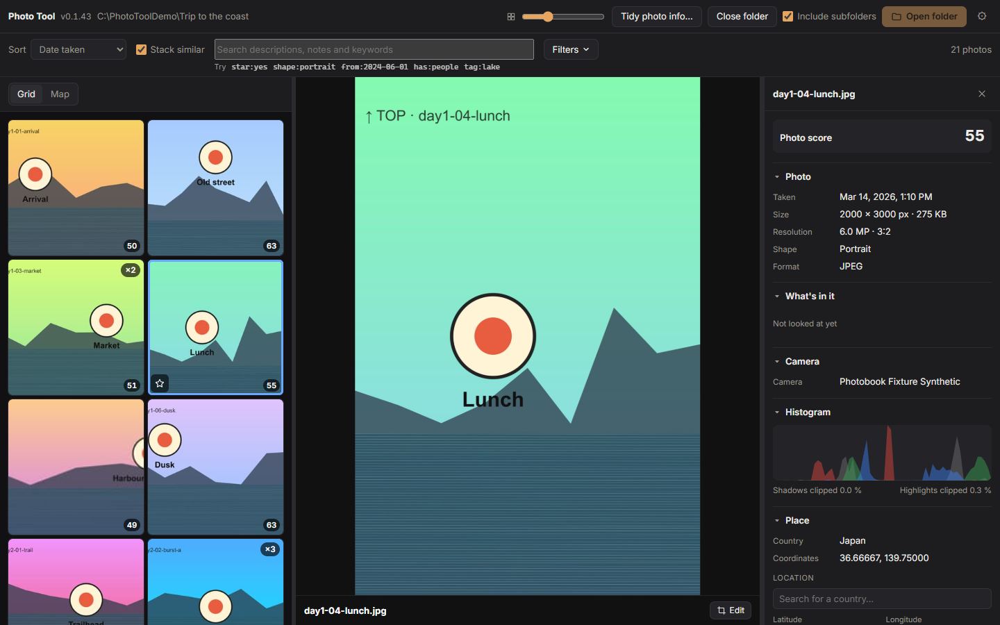

*Every screenshot in this document shows the dark theme; there is no light theme to switch to.*

#### Theme tokens (`shared/web/base.css`, `:root`)

| Token | Value | Use |
|---|---|---|
| `--bg` | `#161618` | body background |
| `--stage` | `#111113` | grid column and grid background |
| `--panel` | `#1d1d20` | bars, details panel, popovers, modals, menu |
| `--panel-2` | `#242428` | inputs, buttons, tiles, notes, filtered row |
| `--panel-3` | `#2d2d32` | hover, toast background, chips |
| `--line` | `#333338` | borders |
| `--line-soft` | `#2a2a2f` | soft dividers, splitters |
| `--text` | `#ecebe7` | text |
| `--muted` | `#9b988f` | secondary text |
| `--accent` | `#e7a65f` | primary buttons, star, active chips, focus border, stack outline, cluster bubble |
| `--accent-strong` | `#f2b871` | primary button hover |
| `--accent-ink` | `#1b1309` | text on accent |
| `--ok` | `#6fc28d` | "Saved", success toast edge |
| `--warn` | `#e9c45f` | (defined, not used by Photo Tool) |
| `--error` | `#ef6e5e` | errors, error toast edge, clipping flags |
| `--select` | `#6aa7ff` | selection outline, selected marker, info toast edge |
| `--radius` | `8px` | common corner radius |
| `--font` | `'Inter', system-ui, -apple-system, sans-serif` | body font |

#### Fixed colours outside the tokens

| Where | Colour |
|---|---|
| Preview pane background | `#111` (text `#fff`) |
| Edit toolbar | background `#18181a`; segmented control `#222` with border `#3a3a3e` |
| Viewer | `#000`; details box `rgba(20,20,22,0.88)` |
| "Unsaved edit" dot and "Edited · not saved" badge | `#d98b2b` |
| Score toast | Up `rgba(46,160,82,0.92)`; Down `rgba(214,64,52,0.92)` |
| Score breakdown points | positive `#4caf6a`; negative `#e05a4f` |
| Histogram | red `#e5483d`, green `#3aa655`, blue `#3b82f6` (fill opacity 0.45); luminance `currentColor` (`#888`, opacity 0.35) |
| Badges on photos | `rgba(0,0,0,0.6)` to `0.65` |

#### Typography

- **Body.** 13px, line-height 1.45, Inter, with antialiasing.
- **Headings.** Weight 600, letter-spacing -0.01em. `h2` is 13px; the start screen's `h1` is 20px; a modal title is 15px.
- **Small text.** `.small` is 11.5px.
- **Code.** Search examples use `ui-monospace, 'Cascadia Mono', Consolas, monospace` at 11px.
- **Number columns.** Counts, scores and version numbers use `font-variant-numeric: tabular-nums`.
- **Fonts are bundled.** `fonts.css` imports `@fontsource` Inter and Montserrat (weights 300 to 900, with italics). Only Inter is used by Photo Tool; Montserrat is there for the shared editor.

#### Spacing and sizes

There is no formal spacing scale. The values used are these:

- **Gaps.** 2, 3, 4, 6, 8, 10, 12, 14 and 16px.
- **Padding.** Bars use 8px 12px. The details body and grid use 12px. Modal bodies use 8px 16px 16px.
- **Controls.**
  - Buttons (`.btn`) are 30px high, 12px horizontal padding, radius 7px.
  - Small buttons (`.btn-small`) are 26px high, 9px padding, 12px font.
  - Icon buttons (`.icon-btn`) are 28 × 28px, radius 6px.
  - Inputs have 5px 8px padding and radius 6px.
  - Checkboxes are 15px.
- **Segmented control (`.seg`).** 2px padding inside a 7px-radius box. The selected button gets `--panel-3` and `--text`.
- **Fixed heights.** Top bar 48px (`.topbar`). Splitter 6px wide.

#### Breakpoints

Only one media query reaches this page: `@media (max-width: 700px)` in `shared/web/base.css`. Under it, `.topbar` (the Photo Tool top bar) changes in four ways:

- its height becomes auto, and it wraps;
- its padding becomes 6px 10px, with a 6px row gap;
- it becomes `position: sticky; top: 0`;
- it gets z-index 20.

The other rules in that query target the editor's classes (`.editor`, `.stage`) and do not apply here. The review screen has no breakpoint of its own. Its column widths are worked out in script (see [Review screen](#review-screen-columns-splitters-sizes)), and the preview keeps a minimum of 300px. The only other size rules that depend on the window are the Filters panel (`min(620px, 100vw − 24px)`) and the map consent card (`min(360px, 100% − 24px)`). A `prefers-reduced-motion: reduce` query turns off the score toast's animation.

#### Icons

`shared/web/components/Icon.tsx` holds an inline SVG icon set: no icon font, nothing fetched. Each icon is a 24 × 24 viewBox, a single path, stroke `currentColor`, stroke-width 1.7, round caps and joins, default size 16px.

- **Icons in the set:** plus, star, eye, eye-off, x, up, folder, undo, redo, lock, rotate, pin, unlock, trash, copy, shuffle, text, image, grid, spread, sparkle, download, upload, check, alert, info, guides, left, down, right, back, swap, crop, fit, front, history.
- **Unknown names** render the `info` icon.
- **Used by Photo Tool:** star, eye, eye-off, x, folder, undo, rotate (mirrored with `scaleX(-1)` for "anticlockwise"), trash, copy, image, grid, download, check, swap, crop.
- **Settings button.** It is the text glyph `⚙` at 17px, not an icon.

#### Layering (z-index)

| Layer | z-index |
|---|---|
| Map overlays (Map: online/offline button, offline notice, consent card) | 1100 (Leaflet panes go up to 1100) |
| Filter bar while the Filters panel is open, and the panel itself | 1200 |
| Toasts | 60 |
| Photo menu (`.ctx-menu`) | 60 |
| Viewer | 55 |
| Modal backdrop | 50 |
| Score breakdown pop-up | 20 |
| Score toast | 5 |

Because the viewer is at 55 and the filter bar is lifted to 1200 only while its panel is open, the viewer still covers the bar.

### Whole window

`GalleryApp` (`photo-tool/web/GalleryApp.tsx`) is a column (`.gallery`, `height: 100%`, flex column). It shows these parts, top to bottom:

1. **`FolderBar`.** Always shown.
2. **`Progress`.** Only while a folder is being read.
3. **`TaggingProgress`.** Only while a folder is open and tagging is running, paused part-way, or stopped with a problem.
4. **`FilterBar`.** Only while a folder is open and it is not empty.
5. **The body**, which is one of:
   - no folder open: `RecentFolders` (the start screen);
   - a folder open and empty: the text "No photos in this folder." (`.muted.pad`);
   - otherwise: `ReviewScreen`.

   "Empty" means `items.length === 0 && progress === null`.
6. **Overlays.** `Viewer` (folder open and not empty), `TidyDialog` (while `tidyOpen`), `LeaveDialog`, `Toasts`.

On mount, `GalleryApp` does three things. It calls `connectDesktop(desktop)`. It runs `loadRecent()` and `loadEditTarget()` once. It installs the review keys with `useReviewKeys(openViewer)`.

#### Layout

```text
+--------------------------------------------------------------------------------------------+
| TOP BAR (.topbar, 48px fixed height, panel bg, bottom border --line)                         |
| Photo Tool  v1.2.3  C:\path\to\folder  [Read-only folder: stars kept in the shared folder]   |
|                          [grid-icon ===slider===] [Tidy photo info…] [Close folder]           |
|                          [x] Include subfolders  [folder-icon Open folder]  [⚙]              |
+--------------------------------------------------------------------------------------------+
| READING BAR (only while scanning)  [=======-------] Reading photos 120 / 400 · about 2 ...  |
+--------------------------------------------------------------------------------------------+
| TAGGING BAR (only while tagging runs/paused)  [===----] Tagging 120 of 2,140   [Pause]     |
+--------------------------------------------------------------------------------------------+
| FILTER BAR (flex-wrap, padding 8px 12px 6px)                                                 |
| Sort [Date taken v]  [x] Stack similar  [Search descriptions, notes and keywords____]        |
|                                         Try star:yes shape:portrait from:2024-06-01 ...     |
|                                         [Filters · 2 v]                   2,140 photos      |
+--------------------------------------------------------------------------------------------+
| FILTERED ROW (only while a filter is on)  [Starred x] [lake x]   Showing 312 of 2,140 · [Clear filter] |
+--------------------------------------------------------------------------------------------+
| BODY (flex: 1): start screen | "No photos in this folder." | review screen                  |
|                                                                                              |
+--------------------------------------------------------------------------------------------+
                                                                    toasts: fixed bottom-right
```

### Start screen (no folder open)

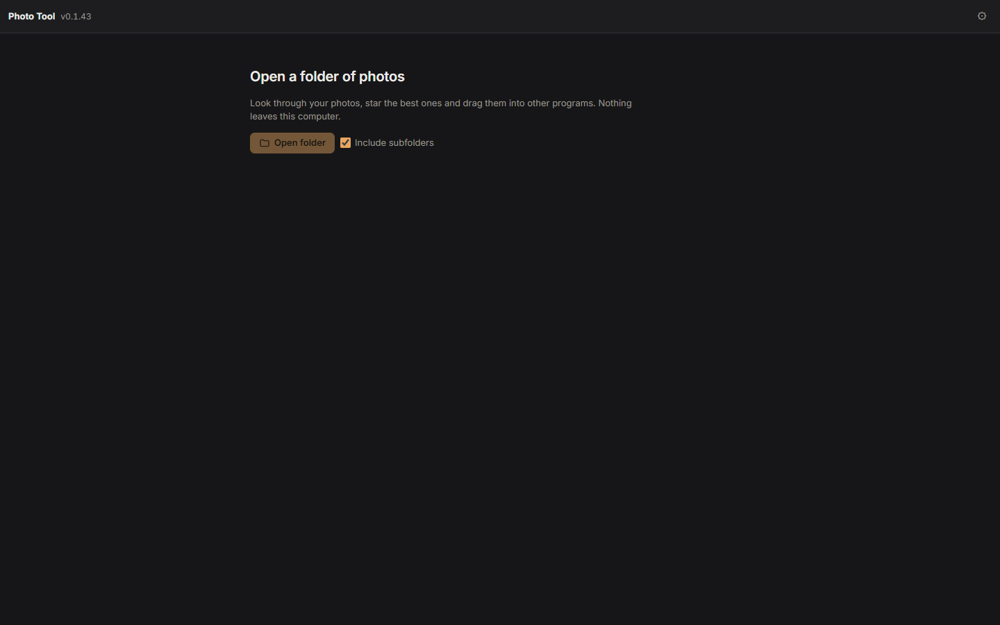

`RecentFolders` (`FolderBar.tsx`) is shown while `root === null`.

#### Layout

```text
+--------------------------------------------------------------------------------------------+
| Photo Tool  v1.2.3                                                                    [⚙]    |  48px top bar: only title, version, Settings
+--------------------------------------------------------------------------------------------+
|        (.gallery-start: padding 48px max(24px, 50% - 360px); column; gap 14px; scrolls)       |
|        Open a folder of photos                                       (h1, 20px)               |
|        Look through your photos, star the best ones and drag them into other programs.        |
|        Nothing leaves this computer.                                 (max-width 560px)        |
|        [folder-icon Open folder]  [x] Include subfolders                                      |
|                                                                                              |
|        Recent folders                                                (h2)                     |
|        +--------------------------------------------------------------------------------+    |
|        | [folder] D:\Photos\Trip 2024                                 with subfolders   |    |  one button per folder, full width
|        +--------------------------------------------------------------------------------+    |
|        | [folder] E:\Old drive\Album (greyed)     Not found — is the drive connected?   |    |  disabled, opacity 0.6
|        +--------------------------------------------------------------------------------+    |
+--------------------------------------------------------------------------------------------+
```

- **Open folder** (`.btn.btn-primary`, folder icon) calls `desktop.pickFolder({ title: 'Open a folder of photos' })`. A chosen folder is passed to `requestOpen(folder, recursive)`. The button is disabled when there is no desktop bridge, so a plain browser cannot open a folder from the page.
- **Include subfolders** is a checkbox bound to the store's `recursive` (default `true`). It applies to the next folder opened. It is not saved.
- **Recent folders.** The section appears only when `recent.length > 0`. Each entry is a button whose text is the full folder path, ellipsised.
  - When the folder exists and was opened recursively, the button also shows the muted note "with subfolders".
  - When `exists` is false, the button is disabled, shows "Not found — is the drive connected?", and has that as its title. Otherwise the title is the folder path.
  - A click calls `requestOpen(r.folder, r.recursive)`. This uses the recursion the folder was last opened with, not the checkbox.
- **Other ways to open a folder.** The desktop app can also hand a folder to the page: a folder given at start, a second launch, or the app menu's File > Open folder (Ctrl+O, defined in `photo-tool/electron/gallery.ts`). These arrive through `desktop.onOpenFolder` and open with the current `recursive` value via `requestOpen`.

### Top bar (`FolderBar`)

The bar is a `<header class="topbar gallery-bar">`, 48px high. It has two groups.

- **Left group** (`.gallery-bar-title`, `flex: 1`):
  - **Photo Tool** in bold;
  - **`v{version}`** muted, 12px, tabular figures, title "Version";
  - **the open folder's path**, muted, ellipsised, with the full path as its title (only when a folder is open);
  - **the badge "Read-only folder: stars kept in the shared folder"**, shown when any item has `infoSource === 'fallback'`. Its title is "This folder can't be written to, so stars and notes are kept in the folder Photo Tool shares with Photobook Editor instead. The editor still sees them."
- **Right group**:
  - **Thumbnail size slider** (only with a folder open): a grid icon followed by `<input type=range min=96 max=320 step=8>`, 120px wide, aria-label and title "Thumbnail size". It calls `setThumbSize`.
  - **Tidy photo info…** (folder open): opens the Tidy dialog. Title: "Remove info saved for photos that are no longer in the folder".
  - **Close folder** (folder open): calls `requestClose()`.
  - **Include subfolders** checkbox (folder open).
  - **Open folder** primary button (folder open; disabled without the desktop bridge).
  - **⚙** (always shown): an icon button, aria-label and title "Settings". It opens the Settings dialog.

### Reading and tagging bars (`Progress.tsx`)

**Reading bar.** It is shown while `progress !== null` and is a `role=progressbar` with aria-label "Reading photos". It contains a bar up to 420px wide and 6px high, filled with the accent colour in proportion `processed / total`. The label is:

- "Looking for photos…" while `total === 0`;
- otherwise "Reading photos {processed} / {total}", followed by " · {remaining}" when an estimate exists.

The estimate comes from `estimateRemaining` in `shared/web/eta.ts`:

- It is null until at least 5 photos are processed and 2 s have passed (and `total > 0`).
- Otherwise it is `elapsed / processed × (total − processed)` seconds.

`formatRemaining` turns it into text:

| Remaining | Text |
|---|---|
| under 60 s | "less than a minute left" |
| 90 minutes or more | "about H hour(s) M minute(s) left" |
| otherwise | "about N minute(s) left" (minutes rounded up) |

**Tagging bar.** It is shown only with a folder open, and only when the store's `tagging` is non-null with `total > 0`.

- **Stopped with a problem.** When `problem` is set and tagging is not running, the bar shows "Tagging stopped: {problem}" in the error colour and a **Try again** button, which calls `setTaggingPaused(false)`.
- **Running, or paused part-way.** When `running`, or `paused && done + failed < total`, the bar shows a progress bar (`done / total`), the text "Tagging {done} of {total}" (numbers localised) with " · paused" appended when paused, and a **Pause** or **Resume** button that toggles `setTaggingPaused`.
- **Otherwise** nothing is shown.

### Review screen: columns, splitters, sizes


`ReviewScreen` is a flex row (`.gallery-main`, `overflow: hidden`). It holds five parts, left to right:

1. the **thumbnail column**;
2. a **6px splitter**;
3. the **preview pane**;
4. a **6px splitter**;
5. the **details column**.

Only the grid and the details body scroll. The preview is clipped to its pane.

#### Layout

```text
+-------------------------------+--+------------------------------------------+--+---------------------------+
| THUMBNAIL COLUMN              |  | PREVIEW PANE (flex: 1, min 300px,        |  | DETAILS COLUMN            |
| width: grid (default 420,     |S |   bg #111, text #fff)                    |S | width: details (default   |
|   min 200, max = room left)   |P |                                          |P |   340, min 260, max 560)  |
| +---------------------------+ |L |  +------------------------------------+  |L | +-----------------------+ |
| | [ Grid | Map ]  (seg,      | |I |  | STAGE (flex 1): photo fitted,       |  |I | | IMG_0042.jpg      [x] | |
| |  padding 8px 12px)        | |T |  | never cropped; wheel zooms,         |  |T | +-----------------------+ |
| +---------------------------+ |T |  | drag pans; mini map top-right       |  |T | | Photo score       74  | |
| | GRID (scrolls, pad 12px,  | |E |  | (160px long side) when zoomed       |  |E | | > Photo               | |
| |  gap 6px, square tiles)   | |R |  |          "+1 · 74" toast            |  |R | | > What's in it        | |
| | [tile][tile][tile]        | |  |  +------------------------------------+  |  | | > Camera              | |
| | [tile][tile][tile]        | |6 |  | CAPTION (padding 8px 12px):          |  |6 | | > Histogram           | |
| | ...                       | |px|  | relDir/IMG_0042.jpg [Favourite]      |  |px| | > Place               | |
| |                           | |  |  | [Hidden] [2 of 5 in stack]           |  |  | | > People              | |
| |                           | |  |  | [Edited · not saved]                 |  |  | | > Date and time       | |
| |                           | |  |  |  ... [Save][Save as…][Save all (3)]  |  |  | | > Description & notes | |
| |                           | |  |  |      [Revert to original][crop Edit] |  |  | |   (body scrolls)      | |
| +---------------------------+ |  |  +------------------------------------+  |  | +-----------------------+ |
+-------------------------------+--+------------------------------------------+--+---------------------------+
```

**Column widths.** All values are in px, from `GalleryApp.tsx`.

- **Constants.** Grid: fallback 420, min 200. Details: fallback 340, min 260, max 560. `PREVIEW_MIN = 300`. `HANDLES = 12` (two 6px splitters).
- **Room.** `room` is the measured `clientWidth` of `.gallery-main`, observed with a `ResizeObserver`.
- **Free space.** `free = room > 0 ? room − 300 − 12 : Infinity`.
- **Details width.** `detailsMax = max(260, min(560, free − 200))`, and `details = clamp(detailsWidth, 260, detailsMax)`.
- **Grid width.** `gridMax = max(200, free − details)`, and `grid = clamp(gridWidth, 200, gridMax)`.
- **Preview.** It takes the rest, with a CSS `min-width` of 300px.

**Splitter** (`components/Splitter.tsx`). A `role=separator`, `aria-orientation=vertical`, 6px wide, coloured `--line-soft`, and `--accent` on hover or drag.

- **Dragging.** Pointer-down with the primary button captures the pointer. Each move sets `clamp(start + dir × dx, min, max)`, rounded. `dir` is `+1` for the grid splitter (dragging right widens the grid) and `-1` for the details splitter (dragging left widens the details).
- **Committing.** On pointer-up, or on lost capture, the last value is committed and saved to `localStorage`. The grid width goes under `gallery.gridWidth` and the details width under `gallery.detailsWidth`, each as a rounded integer string.
- **Reading back.** A stored value is used only if it is a finite number above 0; otherwise the fallback is used.
- **Labels.** "Resize thumbnail column" and "Resize details panel".

**Empty column.** The thumbnail column shows the Grid | Map switch, then one of three things:

- "No photos match the filter" (muted), when `useVisibleItems()` is empty;
- else `MapView` (keyed by root, so a new folder fits its own markers);
- else `Grid` (keyed by root, so a new folder starts at the top).

**Grid | Map switch** (`.gallery-view-switch`). A segmented group, aria-label "Show the photos as", with buttons **Grid** and **Map** (`aria-pressed`). They call `setView`. The map replaces only the thumbnails; the preview and details stay.

### The grid

#### Virtualisation (`photo-tool/web/virtualGrid.ts`, `components/Grid.tsx`)

The grid is a scroll box (`.gallery-grid`, padding 12px, background `--stage`). It contains an inner box whose height is the total content height. Only the rows on screen, plus 2 rows of overscan on each side, are rendered. Each tile is absolutely placed with `transform: translate(x, y)` and has `contain: strict`.

`gridWindow({ count, width, tile, gap, scrollTop, viewport, overscanRows = 2 })` works as follows:

```text
width   = max(0, width)                       // content width = clientWidth − 2×12
cols    = max(1, floor((width + gap) / (tile + gap)))
rowH    = max(1, (width − (cols − 1)×gap) / cols)    // tiles stretch to fill: side ≥ tile unless box < tile
stride  = rowH + gap
rows    = ceil(max(0, count) / cols)
total   = rows > 0 ? rows×stride − gap : 0
top     = max(0, scrollTop)
firstRow= min(rows, max(0, floor(top / stride) − overscan))
endRow  = min(rows, ceil((top + max(0, viewport)) / stride) + overscan)
firstIndex = firstRow×cols ; lastIndex = min(count, endRow×cols) − 1 ; offsetTop = firstRow×stride
```

- **Constants.** `GAP = 6`px. `PAD = 12`px (matching the CSS padding). `tile` is the store's `thumbSize`.
- **Measuring.** The box is measured with a `ResizeObserver`: `width = clientWidth − 24` and `height = clientHeight`.
- **Scrolling.** A scroll is throttled to one `requestAnimationFrame`, which sets `scrollTop = max(0, el.scrollTop − 12)`.
- **Column count.** The current `cols` is published to the store (`setGridCols`), and the grid resets it to 1 when it unmounts. In the current code nothing reads `gridCols` for keys, because Up/Down nudge the score rather than move by a row (see [Open points](#open-points)).
- **Back to the top.** When `sort` or `filter` changes (by reference), the grid scrolls back to the top. A star or an info refresh changes neither, so it does not.
- **Keeping the selection in view.** Whenever `selected`, `viewing` or `cols` changes and the viewer is closed, the grid scrolls just enough to show the selected photo's row:
  - its top is `12 + floor(slot / cols) × stride`;
  - if `top − 12 < scrollTop`, set `scrollTop = top − 12`;
  - else if `top + rowH + 12 > scrollTop + clientHeight`, scroll so that bottom edge sits at the bottom of the box;
  - otherwise do nothing.
- **Matches by meaning.** When the visible list contains photos found only by meaning (`meaningStart !== null`, see [Search](#search)), those photos start on a new row after a row reserved for a note:
  - `pad = ((cols − meaningStart % cols) % cols) + cols`;
  - item `i ≥ meaningStart` occupies slot `i + pad`;
  - the window is computed for `count + pad` slots, and empty slots are skipped;
  - a note "Also matching by meaning" (`role=note`, muted, 13px, bottom border) sits in the row just before the first such slot, at `top = ((meaningStart + pad) / cols − 1) × stride` with height `rowH`.

#### Thumbnail size

- **Range.** `THUMB_MIN = 96`, `THUMB_MAX = 320`, default 160. The slider steps by 8.
- **Clamping.** `clampThumb(px) = min(320, max(96, round(finite(px) ? px : 160)))`.
- **Storage.** The value is saved in `localStorage['gallery.thumbSize']` as a string and read once when the store is created. Failures are ignored.
- **Tile side.** The actual side is `rowH`, which is never smaller than the chosen size unless the column is narrower than one tile.

#### Tiles (`components/Tile.tsx`)

Each tile is a `div.gallery-tile`: square, radius 6px, overflow hidden, background `--panel-2`, a 1px `--line-soft` outline, `user-select: none`.

- **Data.** `data-path` holds the photo path. `title` is `relDir/fileName`, or `fileName` for the top folder.
- **Picture.** `` (the 400px thumbnail), with `loading=lazy`, `decoding=async` and `object-fit: cover`. When the photo has a non-identity edit (unsaved, else saved in info-file mode), the tile uses `<EditedImage fit="cover">` instead.
- **Badges and marks:**

| Element | Position | Shown when | Look |
|---|---|---|---|
| Star badge | top-left (5px), in `.gallery-tile-marks` | `info.star === true` | 20px black circle (`rgba(0,0,0,.6)`), filled star in `--accent`; aria-label "Starred" |
| Hidden badge | top-left, after the star | `info.hidden === true` | 20px circle, eye-off in white; aria-label "Hidden"; the image is dimmed to opacity 0.4 |
| Stack badge `×N` | top-right (5px) | the tile is a stack's top | a pill, min-width 28px, height 20px, 11.5px bold; black at 0.65 opacity; accent background when the stack is open. Label and title: "Show N similar photos" or "Fold N similar photos". A click toggles the stack; a double-click on the badge does not open the viewer |
| Score | bottom-right (5px) | always | a pill, min-width 24px, height 18px, 11px bold, tabular figures; shows the photo score, or "–" until analysed. aria-label "Score N" or "Score not worked out yet" |
| Unsaved dot | bottom-left (7px) | the photo has a pending edit | 9px `#d98b2b` dot; label and title "Edited, not saved" |
| Star button | bottom-left (4px) | on hover or focus-within (opacity transition 0.12s) | 26px icon button on black 0.6; "Star" or "Unstar"; accent when starred. Calls `setStar(path, !starred)` |

- **Outlines** (later rules win):
  - a stack member, or an open stack's top: 2px `--accent`, offset −2px;
  - a stack member also gets an 18% accent tint on its background;
  - `picked` (in the selection): 2px `--select`, offset −2px;
  - `selected` (the photo the details show): 3px `--select`, offset −3px.

  An edited tile redraws the outline in an `::after` layer, because the positioned image would otherwise cover it.
- **Pointer events.** A click or double-click on the star button or stack badge (`.gallery-tile-actions, .gallery-stack-badge`) is not treated as a click on the photo.

| Event | Effect |
|---|---|
| click | `clickSelect(path, { ctrl: ctrlKey \|\| metaKey, shift: shiftKey })` |
| double-click | open the viewer on the photo |
| pointer-down, primary button | `desktop.prepareDrag(dragList(path))` |
| dragstart | `preventDefault()`, then `desktop.startDrag(dragList(path))`. The page's own drag image is never used |
| contextmenu | open the photo menu (see [The photo menu](#the-photo-menu)) |

#### Stacks (`photo-tool/core/galleryStacks.ts`)

A stack folds the near-identical shots of a burst into one tile. A photo belongs to a burst when its fact `groupId` is set (see [Folder facts](#folder-facts-bursts-quality-interesting-colour)).

- **Turning it on.** The **Stack similar** checkbox sets `stacked`. It is on by default, kept for the session, and titled "Show the near-identical shots of a burst as one photo".
- **Which bursts fold.** `stackItems(sorted, facts, openSet)` works on the already-filtered and sorted list. A burst with only one member passing the filter is a plain photo.
- **The stack's top (its face)** is chosen in this order:
  1. the first starred member in sort order;
  2. else the burst's keeper (`isKeeper`);
  3. else the first member shown.
- **Position.** The stack sits where its top sorts. When the stack is open (its id is in `openStacks`), the other members follow the top immediately, in sort order.
- **`stackOf`.** It has an entry for every shown member of a stack of two or more: `{ id, size: number of members passing the filter, open, top }`.
- **Opening and closing.** `openStacks` is in-memory. It is cleared when a folder is opened or closed. It is also extended automatically when a folded photo must be shown: a photo picked on the map, then switching to the grid or opening the viewer.
- **Folding the selected photo's stack.** If the selected photo is a non-top member, the stack's top takes the selection (grid view only).

#### Selection model

Sources: `photo-tool/core/galleryViewer.ts` and the store.

The selection is held in three fields:

| Field | Meaning |
|---|---|
| `selected` | the photo the preview and details show |
| `selection` | every selected photo, in grid order |
| `anchor` | where a Shift range starts |

`clickSelect(visiblePaths, state, path, mods)`:

- **Shift**, with both the anchor and `path` in the list: the range from anchor to `path`, inclusive, in list order. With Ctrl as well, the range is added to the current selection, kept in list order. `selected = path`, and the anchor is unchanged.
- **Ctrl** on a photo already selected: remove it. `selected` becomes the last remaining selected photo if it was the removed one, else stays. `anchor = path`.
- **Ctrl** on a photo not selected: add it, `selected = path`, `anchor = path`.
- **Plain click**: `selected = path`, `selection = [path]`, `anchor = path`.

`select(path)` sets `selected = path`, `selection = path ? [path] : []` and `anchor = path`. If another photo was being edited, it also ends edit mode as Done would (see [Edit mode](#edit-mode)).

**After photos leave the list** (hidden, deleted, filtered out, folded away, or a view switch), `settleSelection` moves the selection on:

- If `selected` is no longer selectable:
  - If it was a stack's top and the view is the grid, select the stack's new top. Failing that, select the remaining single member of that group.
  - Otherwise use `nextAfterRemoval(before, after, selected)`. This keeps the same photo if it is still there. If not, it takes the photo now in its place: `after[k]`, where `k` is how many photos before it stayed. If that runs past the end, it takes the last photo, or none if the list is empty.
- Otherwise the selection is filtered down to the photos still shown.

**Selectable paths.** In the grid these are the tiles (`selectVisible`). On the map they are every filtered photo with stacks unfolded (`selectFiltered`), because every photo has its own marker there.

**First selection.** When a scan finishes with nothing selected, the first visible photo is selected, so the keys have somewhere to start.

**Drag list.** `dragPaths(visible, selection, dragged)` returns every selected photo in grid order when the dragged photo is among them; otherwise just the dragged photo.

### Preview pane

The preview (`components/Preview.tsx`) is a `section.gallery-preview` with aria-label "Preview". It finds the selected photo among `selectFiltered`, so a photo folded into a stack (picked on the map) is still shown. The pane is empty when nothing shown is selected.

**Stage.** The stage shows either `PreviewPicture` (normal) or `EditPane` (edit mode, keyed by `item.key`).

**Caption** (`.gallery-preview-caption`, padding 8px 12px, a top border at white 0.08). It contains, in order:

- the display name in bold: `relDir/fileName`, with the full path as its title;
- badges:
  - **Favourite** (accent) when starred;
  - **Hidden** when hidden;
  - **"{place} of {size} in stack"** when the photo is in a stack. The top is 1, and the other members follow in shown order, whether the stack is folded or not (`selectStackPlace`);
  - **Edited · not saved** (`#d98b2b`, dark text) when the photo has a pending edit;
- outside edit mode, the actions at the right end: **Save**, **Save as…**, **Save all (N)**, **Revert to original** (see [Saving edits](#saving-edits)), then **Edit** (crop icon). The Edit button is titled "Crop and rotate (E)"; while the photo's save is on its way it is disabled and titled "Saving…".

The score toast (see [Score nudges](#score-nudges-up-and-down)) is drawn over the pane.

#### Picture source

`PreviewPicture` uses `usePicture(large = thumb m (1600px), small = thumb s (400px))`. It shows the 1600px picture at once if it is already decoded in the image cache. Otherwise it shows the photo's own 400px picture until the large one arrives. It never shows the previous photo's picture under this photo's name.

The stage component is keyed by `item.key + ':' + editKey(edit)`, so a new photo or a new edit starts fitted.

#### Zoom and pan (`photo-tool/core/previewZoom.ts`, `components/usePreviewZoom.ts`)

`MIN_ZOOM = 1`, `MAX_ZOOM = 8`, and `WHEEL_STEP = 1.2` per notch. The stage is measured with a `ResizeObserver`. A size change resets the view to fit, so dragging a splitter un-zooms. The picture is always drawn at its fitted size and placed with `transform: translate(x,y) scale(zoom)` (transform-origin 0 0). It is hidden (`visibility: hidden`) until its size is known.

- **`fitSize(imgW, imgH, paneW, paneH)`.** The largest size with the picture's shape that fits wholly: `scale = min(paneW/imgW, paneH/imgH)`. It returns 0×0 when any input is ≤ 0.
- **`fitView`.** Zoom 1, centred.
- **`clampPan(v)`.** Per axis: if the scaled size is ≤ the pane, centre it; otherwise clamp the position to `[pane − size, 0]`, so no gap shows at either edge.
- **`zoomAt(v, factor, px, py)`.**
  - `zoom = clamp(v.zoom × factor, 1, 8)`; if it reaches 1, return `fitView`.
  - Otherwise keep the picture point under the pointer fixed: `u = (px − v.x)/(s.w × v.zoom)`, `x = px − u × s.w × zoom` (and the same for y), then `clampPan`.
- **Wheel.** A non-passive `wheel` listener. A wheel with `deltaY < 0` zooms in by 1.2; `deltaY > 0` zooms out by 1/1.2; 0 is ignored. The listener calls `preventDefault` so the page does not scroll.
- **Drag.** With zoom > 1 and the primary button, the stage captures the pointer and moves the view by the pointer delta (clamped). The cursor is `grab`, and `grabbing` while pressed.
- **Double-click.** When zoomed in, it resets to fit. At fit, it opens the viewer.
- **Right-click.** Opens the photo menu.
- **`visibleRect(v)`.** The visible part as fractions of the picture: `x0 = max(0, −x)/sw`, `x1 = min(sw, paneW − x)/sw` (and the same for y). It returns `{0, 0, 1, 1}` when the scaled size is 0.
- **`centreOn(v, fx, fy)`.** Moves the view so the picture point `(fx, fy)` is at the pane centre, then `clampPan`.

**Full-size swap.** When `fit.w × zoom > shape.w`, the view needs more detail than the 1600px picture has. (`shape` is the 1600px picture's natural size, or the edited result's size cut from it.) This applies only when the large picture is shown, or when zoom > 1 on the 400px stand-in. A probe `Image` then loads `/api/gallery/full?path=…&key=…`, and when it arrives the full-size picture replaces the stage image. The view does not move, because the picture is always drawn at the fitted size and scaled. The server ignores `key`; it is there so a changed file (for example after a save to file) gets a new cacheable address.

**Mini map** (`components/MiniMap.tsx`). Shown while zoomed in.

- **Placement.** Top-right of the stage (10px from the top and right). Its long side is 160px and the other side follows the picture's shape. It shows the 400px thumbnail (edited with `fit="cover"` when the photo has an edit).
- **Look.** Opacity 0.75, 1 on hover. A 1px border at white 0.5. Crosshair cursor.
- **View rectangle.** It marks `visibleRect` with a 2px `--accent` border, and darkens everything outside it (`box-shadow 0 0 0 9999px rgba(0,0,0,.55)`).
- **Pointer.** Pointer-down (primary) and drag call `centre(fx, fy)` with the pointer position as clamped fractions. Pointer, double-click and context-menu events stop at the mini map, so the stage behind does not pan or open the viewer.

#### Image cache and preloading (`photo-tool/web/imageCache.ts`, `photo-tool/core/preloadWindow.ts`)

One `ImageCache` instance (`imageCache`) is shared by the grid, the preview and the viewer. It holds 1600px pictures (`size=m`).

| Option or constant | Value | Meaning |
|---|---|---|
| `maxInFlight` | 4 | loads running at once, under the browser's 6 connections per host |
| `capacity` | 40 | decoded images kept (a 1600px picture is about 10 MB decoded) |
| `FAILED_KEPT` | 500 | failed URLs remembered; the oldest is forgotten first |
| `FAILED_FOR_MS` | 15000 | how long a failure blocks a retry |

**Behaviour:**

- **Entries** are kept in a Map in least-recently-wanted order. Each entry is `{ img, ready, waiters }`.
- **`want(urls)`** replaces the wanted list (deduplicated). It then:
  1. cancels every loading entry that is neither wanted nor pinned (sets `img.src = ''` and drops the entry);
  2. touches wanted entries from last to first, so the most wanted becomes the most recent;
  3. pumps the queue.
- **`pump()`** walks the wanted list in order.
  - Only the first wanted URL, `wanted[0]` (the photo on screen), may start past the cap, and it starts with high fetch priority.
  - If `wanted[0]` is already present or failed, it loses that privilege.
  - Every later URL starts only while `loads < maxInFlight`, with low priority. The walk stops at the first URL that would exceed the cap.
- **Starting a load** creates an `Image` with `decoding = 'async'`. On `onload` it calls `img.decode()`. Success, or a decode failure with `naturalWidth > 0`, marks the entry ready. On error the entry is dropped, the failure is recorded, and the waiters are rejected.
- **Eviction.** After each success, ready entries beyond capacity are dropped, least recently wanted first. An entry that is still wanted or pinned is never dropped.
- **`load(url, signal)`** resolves at once if the image is ready. It rejects at once if the URL failed lately or the signal is already aborted. Otherwise it pins the URL, joins or starts a high-priority load, and unpins when the load settles or the signal aborts.
- **`get(url)`** returns a ready image or `undefined`. `failed(url)` reports a recent failure.

**`usePicture(large, small)`.** Returns `large` if it is ready in the cache. Otherwise it returns `small` and calls `cache.load(large, abortSignal)`, re-rendering when the load resolves. The load is aborted when the component moves on to another photo.

**`preloadOrder(index, count, { ahead = 20, behind = 5, direction = 1 })`.** Returns the places to load, most wanted first, never `index` itself, never a duplicate, and never anything outside `[0, count)`:

1. the next `min(3, ahead)` places in the direction of travel (`LEAD = 3`);
2. then one place behind (if `behind > 0`);
3. then the rest of the places ahead, up to `ahead`;
4. then places behind from 2 to `behind`.

A direction of −1 mirrors the order.

**Who asks for what:**

- **Grid**, while the viewer is closed and a photo is selected: `want([at, ...preloadOrder(at, n, { direction })])`, mapped to 1600px thumbnail URLs. The direction is −1 when the new index is below the last one, +1 when it is above, and unchanged when it is equal. When the grid unmounts it calls `want([])`.
- **Viewer**: the same, from the viewed index.

`pathIndex(list)` caches a path→index Map per list array in a WeakMap.

### Full-screen viewer

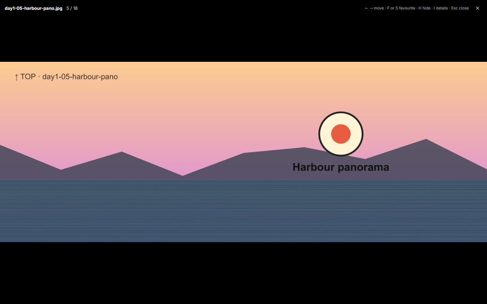

`components/Viewer.tsx`. It opens on a double-click on a tile, a double-click on the preview at fit, or Enter/Space on the selected photo (see [Review keys](#review-keys)).

**Opening.** `openViewer(path)` does nothing while edit mode is open. Otherwise it unfolds the photo's stack if the photo is folded away, then sets `viewing = path`.

**Display.** It is a fixed overlay over the whole window (`role=dialog`, `aria-modal`, aria-label "Photo viewer"), background `#000`, z-index 55. It steps through the grid's own visible list (filtered, sorted and stacked as the grid shows it).

#### Layout

```text
+--------------------------------------------------------------------------------------------+
| IMG_0042.jpg  [★] [eye-off]  12 / 340        ← → move · F or S favourite · H hide · I details · Esc close  [x] |
|   (top bar: absolute, padding 10px 14px, gradient rgba(0,0,0,.7) → transparent)              |
|                                                                                              |
|                      PHOTO: 1600px picture, object-fit contain, 100% × 100%                  |
|                                                                                              |
|                             (★ 180px mark animates on S/F, 0.8s)                             |
|                                                          +-------------------------------+  |
|                                                          | DETAILS (I): 320px wide,      |  |
|                                                          | right 16px, bottom 16px,      |  |
|                                                          | max-height 100% − 80px        |  |
|                                                          | IMG_0042.jpg                  |  |
|                                                          | Taken   12 Jun 2024, 14:03    |  |
|                                                          | Camera  …                     |  |
|                                                          | Size    4032 × 3024 px · 3 MB |  |
|                                                          | People  Ann, Bob              |  |
|                                                          | Description …                 |  |
|                                                          +-------------------------------+  |
+--------------------------------------------------------------------------------------------+
```

**Bar.** It shows:

- the file name in bold, with the full path as its title;
- a star icon (accent, filled) when starred;
- an eye-off icon when hidden;
- "{index+1} / {count}";
- the key hint "← → move · F or S favourite · H hide · I details · Esc close" (small, muted);
- a close button (x), titled "Close (Esc)", which calls `closeViewer(item.path)`.

**Image.** `usePicture(1600px, 400px)` in a fresh `` per photo, sized 100% with `object-fit: contain`. **The viewer does not show edits and does not zoom** (see [Open points](#open-points)).

**Details panel.** Toggled with I. It is read-only and shows Taken (`formatTaken`, or "Unknown"), Camera (if known), Size ("W × H px · formatSize"), People (when any) and Description (when any).

**Keys.** A capturing `keydown` listener on `window` calls `stopPropagation` on every key, so nothing else on the page sees keys while the viewer is open. It ignores keys held with Ctrl, Alt or Meta.

- **Default actions blocked.** It calls `preventDefault` for: ArrowLeft, ArrowRight, ArrowUp, ArrowDown, PageUp, PageDown, Home, End, Space, Enter, Tab, Escape, and s/S, f/F, h/H, i/I.
- **Key meanings** come from `viewerStep(index, count, key)`:

| Key | Action |
|---|---|
| ArrowRight | next photo, stopping at the last |
| ArrowLeft | previous photo, stopping at the first |
| s, S, f, F | star or unstar the shown photo. A 180px star "mark" plays a 0.8s animation (filled accent for on, white outline for off). Presses are tracked in a `wanted` map, so pressing S twice quickly unstars again before the first save returns |
| h, H | `select(shown)` then `toggleFlag('hidden')`. Only the shown photo is affected, not an earlier multi-selection |
| i, I | toggle the details panel |
| Escape | close, selecting the last photo shown |

  Action keys ignore auto-repeat. Arrow keys repeat.
- **Blurring on open.** When the viewer opens, it blurs the focused element, so a field being typed in saves its text first.

**When the shown photo leaves the list** (for example it is starred under a "Not starred" filter, or hidden), the viewer moves to the photo now in its place, at index `min(last, length − 1)`. If the list becomes empty, it closes without changing the selection.

**Closing.** `closeViewer(last)` sets `viewing = null`. When `last` is non-null, it also selects that photo alone.

### The details panel

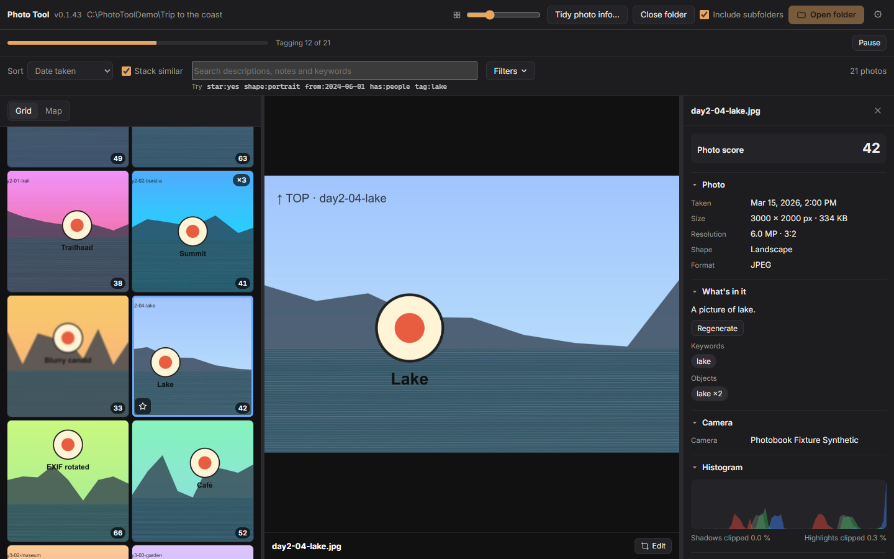

`components/Details.tsx`. It shows the item whose `path === selected`. If there is none, it renders nothing (the column stays as a blank panel). The inner component is keyed by path, so all local state starts again for another photo.

#### Layout

```text
+---------------------------------------+   column: default 340px, 260–560px, bg --panel, left border
| IMG_0042.jpg (ellipsis)          [x]  |   head: padding 10px 12px, bottom border
+---------------------------------------+
| +-----------------------------------+ |   body: padding 12px, gap 14px, scrolls
| | Photo score                    74 | |   .gallery-score; hover/focus → breakdown pop-up
| +-----------------------------------+ |
| (note: read-only folder / info error) |
| ▾ Photo                               |
|   Taken       12 Jun 2024, 14:03 [changed]
|   Size        4032 × 3024 px · 3.1 MB |   fact rows: grid 88px | 1fr
|   Resolution  12.2 MP · 4:3           |
|   Shape       Landscape               |
|   Format      JPEG                    |
|   Folder      Day 2                   |
| ▾ What's in it      (see below)       |
| ▾ Camera                              |
|   Camera / Lens / Focal length / Aperture / Shutter / ISO / Exposure / Flash
| ▾ Histogram   [80px SVG]              |
|   Shadows clipped 0.4 %  Highlights clipped 2.3 %
| ▾ Place                               |
|   Country     France                  |
|   Coordinates 48.85837, 2.29448       |
|   LOCATION                    Saved   |
|   [Search for a country…]             |
|   Latitude [____]  Longitude [____]   |
|   Place name [__________]             |
| ▾ People                              |
|   PEOPLE                              |
|   (Ann x) (Bob x)                     |
|   [Add a name, press Enter]           |
| ▾ Date and time                       |
|   [2024-06-12T14:03:00 ]              |
|   Use the camera's date               |
| ▾ Description and notes               |
|   DESCRIPTION [__________]            |
|   NOTES [textarea, 4 rows]            |
+---------------------------------------+
```

**Head.** The file name in bold, ellipsised, with the path as its title. A close button (x, aria-label "Close details") calls `select(null)`.

**Score card** (`ScoreCard.tsx`). It is focusable (`tabIndex 0`) and shows "Photo score" with the total at 22px bold. When the photo has not been analysed yet, it adds "still reading the photo". Hovering or focusing it shows a pop-up headed "What made this score":

- a table with one row per non-zero line: the label, its "why" text (muted), and signed points (green "+N", red "−N" with a real minus sign);
- for an unanalysed photo, the row "Focus, exposure and colour are added once the photo has been read.";
- a Total footer;
- the note "Up and Down nudge it by 1. Favourite +50, hidden −50."

The score itself is defined in `photo-tool/core/photoScore.ts` (summarised in [Photo score](#photo-score)).

**Notes under the score card:**

- when `infoSource === 'fallback'`: "This folder can't be written; info is kept in the folder Photo Tool shares with Photobook Editor";
- when `infoError` is set: its text, in an error-bordered note.

**Sections** (`components/Section.tsx`). Each section has a header button with a chevron (▾ open, ▸ folded) and `aria-expanded`. Each is open by default. The open/folded state is saved per section id in `localStorage['gallery.sections']` as a JSON object `{ [id]: boolean }`; a missing id counts as open. Malformed storage reads as `{}`. A `lazy` section renders nothing while folded; only Histogram is lazy.

| id | Title | Content |
|---|---|---|
| `photo` | Photo | **Taken**: `formatTaken(effectiveDate)` (locale `dateStyle: medium, timeStyle: short`) or "Unknown", plus a **changed** badge when `info.date` is a string (title "The date was changed here; the camera's is kept in the photo"). **Size**: "W × H px · formatSize" (≥1 MB gives "x.x MB", else "N KB" with a minimum of 1). **Resolution**: "x.x MP · ratio". **Shape**: Square, Landscape or Portrait. **Format**: upper-case format, or "Unknown". **Folder**: relDir (only when not top) |
| `whatsinit` | What's in it | see [What's in it](#whats-in-it) |
| `camera` | Camera | rows only for fields present: Camera; Lens; Focal length (`formatFocal`: "N mm", plus " (M mm in 35 mm terms)" when the 35mm value differs by 1 or more); Aperture "f/N"; Shutter "1/N s" below 1 s, else "N s"; ISO; Exposure ("+0.7 EV", "−1 EV", "0 EV"); Flash ("Fired" or "Did not fire"). With none: "No camera details in this file" |
| `histogram` | Histogram (lazy) | see below |
| `place` | Place | with a location: **Country** (from `POST /api/places/suggest` with `[[lon, lat]]`, the first name, "…" while waiting) and **Coordinates** (lat, lon to 5 decimals); then the **Location** field |
| `people` | People | the **People** field |
| `date` | Date and time | the **Date and time** field |
| `notes` | Description and notes | the **Description** and **Notes** fields |

**Aspect ratio names** (`aspectRatio` in `shared/core/photoFacts.ts`). The ratio is long side over short side. It is given the first matching name within 2%: 1:1, 5:4, 4:3, 3:2, 16:9, 2:1. Otherwise it is written "r.rr:1".

**Histogram** (`Histogram.tsx`, `photo-tool/core/histogram.ts`). The page loads the 1600px thumbnail, draws it into a canvas scaled so the long side is at most 256px, and bins the pixels into 64 bins each for R, G, B and luminance (`0.2126R + 0.7152G + 0.0722B`; alpha ignored).

- **Drawing.** An 80px-high SVG (viewBox 256×80, `preserveAspectRatio=none`) draws filled areas for L, R, G and B, normalised to the single peak across all four.
- **Clipping line.** When the item has an analysis, a line beneath reads "Shadows clipped x.x %" and "Highlights clipped x.x %". Either is shown in the error colour when it is at least 0.02 (`FLAG`).
- **Failure.** "The histogram could not be drawn."

#### How edits save

Every info edit goes through `saveInfo(path, patch)` → `PATCH /api/gallery/info`. A null value in the patch deletes that field.

- **Confirmation.** On success the field's label shows a green "Saved" (`role=status`) for 1800 ms.
- **Failure.** An error toast shows the server's message, and the field keeps what was typed.

| Field | Control | When it saves | What is written |
|---|---|---|---|
| Description | `<input type=text>`, label "Description" | on blur; Enter blurs | `{ description: value }`, or `null` when the trimmed value is empty. Not sent if unchanged or already sent |
| Notes | `<textarea rows=4>` (vertical resize) | on blur | `{ notes: value }`, or `null` when empty after trim |
| People | chips plus an input with placeholder "Add a name, press Enter" and a datalist of the folder's people (`GET /api/gallery/people`) minus those already on the photo (case-insensitive) | Enter, a comma (also inside pasted text), or blur with text adds the name; a chip's x removes it | the whole list after `normalisePeople` (trim, drop empties, deduplicate ignoring case, first spelling wins): `{ people: [...] }`, or `null` when empty |
| Date and time | `<input type=datetime-local step=1>` (uncontrolled, keyed by the shown value), label "Date and time taken" | on blur or Enter | see the rules below |
| Location | `LocationInput`: "Search for a country…" (up to 6 matches from `GET /api/places`, a case-insensitive substring match; clicking one sets the place name and saves), Latitude, Longitude, Place name | when focus leaves the whole group, or Enter in an input | `{ location: { lat, lon, name? } }` or `{ location: null }` |

**Date rules** (`photo-tool/core/galleryEdit.ts`):

- **Display.** `toDateTimeLocal(iso)` matches `^(\d{4}-\d{2}-\d{2})[T ](\d{2}:\d{2})(?::(\d{2}))?` and gives `YYYY-MM-DDTHH:MM:SS`, with seconds defaulting to 00. Anything else gives `''`.
- **Parsing.** `fromDateTimeLocal(value)` uses the same pattern. It returns `YYYY-MM-DDTHH:MM:SS` (no time zone), or null if the value does not match or is not a real date. The check parses `iso + 'Z'` and compares the result back.
- **Committing a value:**
  - Unchanged: either it equals the shown value, or it parses to the shown value (the input drops ":00"). Clear any error and stop.
  - Empty, and the input reports `badInput`: show "Finish the date and time."
  - Empty otherwise: if a date override exists, save `{ date: null }`; else put the shown value back.
  - Does not parse: show "That is not a valid date and time."
  - Otherwise save `{ date: iso }`.
- **Going back.** When an override exists, a link "Use the camera's date" saves `{ date: null }`.

**Location rules** (`parseLocation`):

- **Each coordinate** is trimmed. Empty counts as absent. Otherwise it must be a finite number ("Latitude must be a number.") and within ±90 or ±180 ("Latitude must be between -90 and 90." / "Longitude must be between -180 and 180.").
- **Both coordinates absent.** With a name: "Add a latitude and longitude for this place, or clear the name." Without a name: a clear (`null`).
- **Only one coordinate:** "Enter both latitude and longitude."
- **Otherwise** `{ lat, lon }`, plus `name` if non-empty.
- **Clearing.** A clear when the photo has no saved override (`hasOverride` false) just restores the camera's values.
- **Initial values.** The fields start from `effectiveLat`/`effectiveLon` (the camera GPS or the override) and `info.location.name`. They reset whenever those change.

**Unsaved text when the panel goes away.** Selecting another photo or closing the panel does not always blur the field first. So when the panel unmounts:

- description and notes are saved if changed;
- a valid changed date is saved;
- location fields are saved through `locationToSave`, which skips unchanged, invalid, or "clear with nothing to delete" values.

**Drafts survive a reply.** `useDraft` keeps a text field's draft separate from the saved value. The draft follows the saved value only while it holds nothing unsaved, so neither a save reply nor another program's change overwrites text still being typed. `sent` remembers the value on its way, so it is not sent twice.

**Saves are queued per photo.** Within the store, saves of one photo go to the server one after another, and the photo is updated only from the last reply (see [Client store](#client-store)).

### What's in it


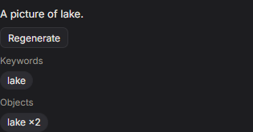

`components/WhatsInIt.tsx`. This is the details section that shows what photo tagging found. The data is `item.tags: PhotoTags = { state: 'off' | 'waiting' | 'done' | 'failed'; description: string | null; keywords: string[]; objects: { label, count }[]; canRegenerate?: true }`. The server sends at most 12 keywords per photo.

#### Layout

```text
| ▾ What's in it                                         |
|   (Not working: a chosen model is damaged or would not  |   error note, only when tagging.notWorking is non-empty
|    load. See Settings.)                                 |
|   A dog running along a sandy beach at sunset.          |   description, line-height 1.4; title "Written by <model>"
|   [Regenerate]                                          |   .btn-small; busy: "Writing a new description…" (disabled)
|   Keywords                                              |   muted label on its own line
|   (beach) (dog) (sunset) (sand)                          |   chips: toggle a keyword filter; on = accent
|   Objects                                               |
|   (dog) (person ×2)                                     |   "label ×count" when count > 1
```

**States:**

| Condition | Shown |
|---|---|
| `state === 'off'` | "Tagging is off." followed by a **Settings** link (styled as an accent underlined button) that opens the Settings dialog. Nothing else |
| `tagging.notWorking.length > 0` | "Not working: a chosen model is damaged or would not load. See Settings." (error note) |
| `state === 'waiting'` and no description, keywords or objects | "Not looked at yet" |
| `state === 'failed'` | "Couldn't look at this photo" (error note) |
| description present | the sentence. Its title is "Written by {model label}" once known |
| description and `canRegenerate` | a **Regenerate** button |
| keywords | "Keywords", then one chip per keyword |
| objects | "Objects", then one chip per object, reading "label" or "label ×count" |

**Chips.** Each chip is a toggle button with `aria-pressed`. It is "on" when the filter's `tags` contain `{kind, value}`. Its title is "Show only photos with this" or "Stop filtering by this". A click calls `toggleTagFilter({ kind: 'keyword' | 'object', value })`.

**Regenerate.**

- **Tooltip.** "Ask {model} to describe this photo again", or "Ask the descriptions model to describe this photo again" while the model is unknown. aria-label "Regenerate the description".
- **Request.** A click calls `POST /api/gallery/tagging/regenerate { job, path }`. The reply is the photo's new `PhotoTags`, which replaces `item.tags`.
- **Busy state.** While the request runs the button is disabled with `aria-busy`, and its label is "Writing a new description…".
- **Busy set.** The busy state is kept in a module-level set of paths with listeners, read through `useSyncExternalStore`. It therefore lasts while the section is folded, the panel shows another photo, or the panel is closed, and a second request for the same photo is not sent.
- **Failure.** On failure an error toast shows the server's message, and the old text stays. If another folder was opened meanwhile, the reply is dropped and no toast is shown.

**Model label.** The label is read from `GET /api/gallery/models`: the catalogue entry whose id is `settings.describe`. It is fetched on mount and again each time the Settings dialog closes.

### Filter bar, search box and filter panel

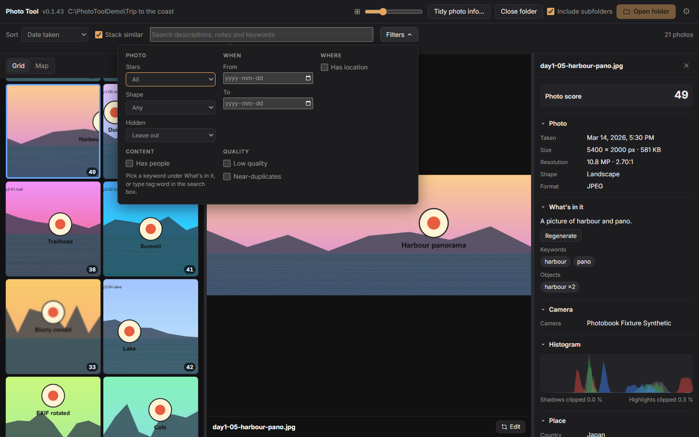

`components/FilterBar.tsx`. The filter bar is shown only while a folder is open and it is not empty. It is a `role=search` element with aria-label "Sort and filter". It wraps, with gaps of 8px between rows and 14px between items, and padding 8px 12px 6px. While the Filters panel is open, the bar is raised to z-index 1200 so the panel sits above the map's overlays.

#### Layout

```text
+------------------------------------------------------------------------------------------------------+
| Sort [Date taken   v]  [x] Stack similar  +-------------------------------+  [Filters · 2 v]  2,140 photos |
|                                           | Search descriptions, notes    |  (accent border   (only when no |
|  (row items 30px high)                    | and keywords                  |   while N > 0)    filter is on)  |
|                                           +-------------------------------+                                  |
|                                           Try star:yes shape:portrait from:2024-06-01 has:people tag:lake     |
|                                           (11px hint line; turns red with an error message)                    |
|                                 search box: flex 1 1 260px, min 200px, max 460px                               |
+------------------------------------------------------------------------------------------------------+
                                                  +----------------------------------------------+
                                                  | FILTERS PANEL (role=dialog), absolute under  |
                                                  | the button, right edge on the button's,      |
                                                  | top +6px, width min(620px, 100vw − 24px),    |
                                                  | padding 14px 16px 16px, grid of auto-fill    |
                                                  | minmax(180px, 1fr) columns, gap 12px 16px,   |
                                                  | shadow 0 8px 30px rgba(0,0,0,.45)            |
                                                  | PHOTO          WHEN           WHERE          |
                                                  | Stars          From           Folder         |
                                                  | [All      v]   [date    ]     [All folders v]|
                                                  | Shape          To             [ ] Has        |
                                                  | [Any      v]   [date    ]         location   |
                                                  | Hidden                                       |
                                                  | [Leave out v]                                |
                                                  |                                              |
                                                  | CONTENT        QUALITY                       |
                                                  | [ ] Has people [ ] Low quality               |
                                                  | (lake ×) -or-  [ ] Near-duplicates           |
                                                  | "Pick a keyword                              |
                                                  |  under What's                                |
                                                  |  in it, or type                              |
                                                  |  tag:word in the                             |
                                                  |  search box."                                |
                                                  +----------------------------------------------+
                                     (at the full 620px, three 180px+ columns fit, so Content and
                                      Quality wrap to columns 1 and 2 of a second row; Folder appears
                                      only when the folder has subfolders)
```

Group legends are 11px, weight 600, upper case, letter-spacing 0.06em, muted. A select or date field is a column: a 12px muted label above the control.

**Controls, left to right:**

1. **Sort** select, with these options:

   | Label | Key |
   |---|---|
   | Date taken | `date` |
   | Photo score | `score` |
   | Most interesting | `interesting` |
   | Main colour | `colour` |
   | File name | `name` |

2. **Stack similar** checkbox.
3. **Search box.** `type=search`, placeholder "Search descriptions, notes and keywords", aria-label "Search photos". Beneath it is a hint line (`aria-live=polite`). Normally the line reads "Try" followed by the query examples in monospace, in list order: `star:yes`, `shape:portrait`, `from:2024-06-01`, `has:people`, `tag:lake`. When a typed query word is bad, the line shows the error message in red instead.
4. **Filters** button. `aria-haspopup=dialog`, `aria-expanded`, a chevron that rotates 180° while open. Its label is "Filters", or "Filters · N" when N panel filters are on, and it has the accent border and text while N > 0.
5. **Count.** "N photos" (or "1 photo"), localised, shown only while no filter is on. N is the folder's whole item count, hidden photos included.

#### Filtered row ("Showing X of Y · Clear filter")

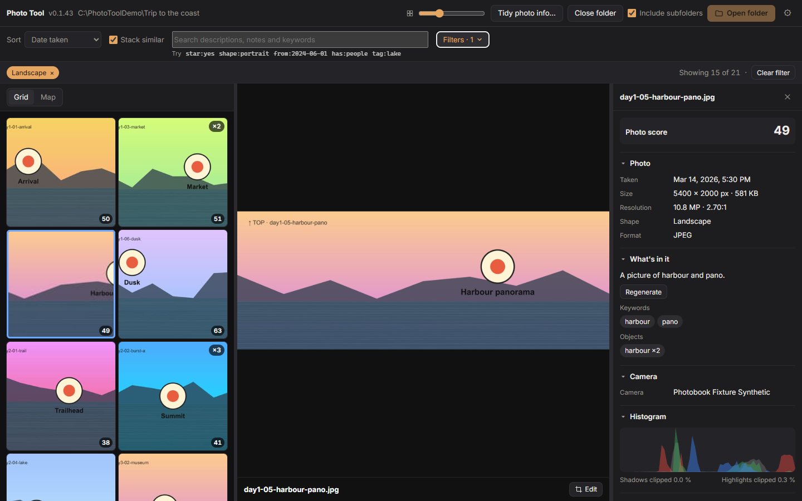

`components/FilteredRow.tsx`. The row is shown only while `isFilterActive(filter)`. It is a `role=region` with aria-label "Active filters", background `--panel-2`, padding 6px 12px.

#### Layout

```text
+------------------------------------------------------------------------------------------------+
| (Starred ×) (2024-06-01 → 2024-06-30 ×) (lake ×) (Has people ×)    Showing 312 of 2,140 · [Clear filter] |
|  chips: accent pills, 12px                                         (pushed right, tabular figures)       |
+------------------------------------------------------------------------------------------------+
```

- **Chips.** One chip per filter that is on, in `FILTERS` order. Each chip has a × button with aria-label "Remove filter {text}" and title "Remove this filter". The × calls `setFilter(chip.clear)`.
- **Count.** "Showing X of Y", localised, with `aria-live`.
  - X is the number of photos that pass: stacks unfolded, and matches by meaning included (`selectFiltered`).
  - Y is every photo in the folder, hidden ones included.
  - The count therefore counts photos, not tiles, even with Stack similar on (pinned by e2e).
- **Clear filter** (`.btn-small`) empties the search box draft and the error, then calls `clearFilter()`.

#### Filter state (`GalleryFilter`, `photo-tool/core/gallerySort.ts`)

```ts
interface GalleryFilter {
  starred?: 'yes' | 'no';
  from?: string;               // YYYY-MM-DD, inclusive
  to?: string;                 // YYYY-MM-DD, inclusive
  lowQuality?: boolean;
  nearDuplicates?: boolean;
  orientation?: 'portrait' | 'landscape';
  hasLocation?: boolean;
  hasPeople?: boolean;
  hidden?: 'show' | 'only';    // absent: hidden photos are left out
  relDir?: string;             // '' = top folder
  text?: string;               // the search text
  tags?: TagFilter[];          // TagFilter = { kind: 'keyword' | 'object'; value: string }
}
```

**Lifetime.** The filter lives in memory for the session and is never saved. Opening a new folder keeps the sort and every filter except `relDir`. `setFilter(patch)` merges the patch and deletes any key set to `undefined`.

#### The list of filters (`photo-tool/core/galleryFilters.ts`)

One table, `FILTERS`, drives everything about filters: the panel, the chips, the Filters · N badge, `isFilterActive`, and the query words. A unit test fails if a `GalleryFilter` key has no entry.

- **Panel groups**, in order: `Photo`, `When`, `Where`, `Content`, `Quality`.
- **`isFilterActive(f)`** is true when any entry's `isOn` is true. That includes non-empty search text.
- **`activeFilterCount(f)`** counts the entries that are on and have a panel group, so the search text is left out.

| Entry id | Keys | Group | Panel control (exact labels) | Chip text | On when |
|---|---|---|---|---|---|
| `starred` | starred | Photo | select **Stars**: All / Starred (`yes`) / Not starred (`no`) | "Starred" / "Not starred" | value set |
| `orientation` | orientation | Photo | select **Shape**: Any / Portrait / Landscape | "Portrait" / "Landscape" | value set |
| `hidden` | hidden | Photo | select **Hidden**: Leave out / Show (`show`) / Only (`only`) | "Hidden shown" / "Only hidden" | value set |
| `dates` | from, to | When | date inputs **From** and **To**. From's `max` is the To value; To's `min` is the From value | "{from} → {to}", "From {from}", or "Until {to}" (one chip; its × clears both) | either set |
| `relDir` | relDir | Where | select **Folder**: "All folders", "Top folder", then each subfolder. Shown only when the folder has 2 or more distinct relDirs. Option values are `d:<relDir>` | "Top folder" or the relDir | `relDir !== undefined` |
| `hasLocation` | hasLocation | Where | checkbox **Has location** | "Has location" | true |
| `hasPeople` | hasPeople | Content | checkbox **Has people** | "Has people" | true |
| `tags` | tags | Content | the active tag chips, each with × ("Remove filter {value}") calling `toggleTagFilter`; with none, the note "Pick a keyword under What's in it, or type tag:word in the search box." | one chip per tag, reading the value; its × removes just that tag | non-empty |
| `lowQuality` | lowQuality | Quality | checkbox **Low quality** | "Low quality" | true |
| `nearDuplicates` | nearDuplicates | Quality | checkbox **Near-duplicates** | "Near-duplicates" | true |
| `text` | text | (none) | none: the search box holds it | no chip | trimmed text non-empty |

**Panel controls write `undefined` for "off".** A select set to its first ("off") option, an empty date, and an unticked checkbox all write `undefined`.

**The subfolder list.** The list (`dirs`) is the distinct `relDir` values of all items, sorted with `''` first and the rest by `localeCompare`.

**Panel behaviour** (`components/FilterPanel.tsx`):

- On open, focus goes to the panel's first select, input or button.
- **Esc** inside the panel closes it, stops propagation, and returns focus to the Filters button.
- A pointer-down outside both the panel and its button closes it without moving focus. The button itself toggles it.
- Because the panel is a `role=dialog`, the review keys ignore keys typed inside it (pinned by e2e).

#### Filter matching rules (`filterItems`)

`filterItems` keeps the order of its input. A photo passes when every filter that is set passes:

1. **Hidden.**
   - With `hidden === 'only'`, a photo passes only if `info.hidden === true`.
   - Otherwise a hidden photo fails unless `hidden === 'show'`.
2. **Starred.** `yes` requires `info.star === true`. `no` requires that it is not.
3. **Dates.** If `from` or `to` is set, the day is `effectiveDate.slice(0, 10)`. A photo with no date fails. The day must satisfy `day >= from` and `day <= to` (string comparison, both ends inclusive).
4. **Low quality.** The photo must have facts, and at least one flag set: `blurry`, `dark`, `bright` or `lowRes`.
5. **Near-duplicates.** The photo's fact `groupId` must be non-null.
6. **Orientation.** Portrait requires `height > width`. Landscape requires `width > height`. A square photo matches neither.
7. **Has location.** Requires `effectiveLat !== null`.
8. **Has people.** Requires `info.people` to be a non-empty array.
9. **Folder.** If `relDir` is defined, the photo's relDir must equal it exactly.
10. **Text.** The trimmed, lower-cased query must be a substring of the haystack. The haystack is these values joined with `\n` and lower-cased:
    - `info.description`;
    - `info.notes`;
    - `tags.description`;
    - every keyword;
    - every object label.

    Only string values are included. People, file names and dates are **not** searched.
11. **Tags.** Every tag filter must be present:
    - a keyword filter requires `tags.keywords.includes(value)` (exact, case-sensitive);
    - an object filter requires some `objects[].label === value`.

#### Query words in the search box (`photo-tool/core/galleryQuery.ts`)

Typing `key:value` words turns them into filters (chips). The words come from the `query` entries of `FILTERS`.

**Grammar:**

```text
box    := word ( ' '+ word )*      split on spaces outside double quotes; each '"' toggles quoting
word   := key ':' value | text
key    := letters, matched case-insensitively against the known keys   (regex /^([a-z]+):(.*)$/is)
value  := '"' chars ['"'] | chars  (unquote: a leading '"' is removed, and a trailing '"' if present)
```

**Known keys and values:**

| Key | Values | Sets | Bad-value hint | Example shown |
|---|---|---|---|---|
| `star` | `yes`, `no` (case-insensitive) | starred | `try star:yes or star:no` | `star:yes` |
| `shape` | `portrait`, `landscape` | orientation | `try shape:portrait or shape:landscape` | `shape:portrait` |
| `hidden` | `show`, `only` | hidden | `try hidden:show or hidden:only` | none |
| `from` | a real day `YYYY-MM-DD` (validated through `Date.UTC`) | from | `try from:YYYY-MM-DD` | `from:2024-06-01` |
| `to` | a real day `YYYY-MM-DD` | to | `try to:YYYY-MM-DD` | none |
| `folder` | `top` (only if the folder has a top-level photo), or a subfolder name matched case-insensitively against the full relDir; the result uses the exact relDir | relDir | `no folder named {value}` | none |
| `has` | `location`, `people` (two entries, tried in list order) | hasLocation or hasPeople | `try has:location or has:people` | `has:people` |
| `tag` | any non-blank value; trimmed and lower-cased | adds `{kind:'keyword', value}` | `try tag:<word>` | `tag:lake` |
| `object` | any non-blank value; trimmed and lower-cased | adds `{kind:'object', value}` | `try object:<word>` | none |
| `is` | `lowquality`, `duplicate` | lowQuality or nearDuplicates | `try is:lowquality or is:duplicate` | none |

Value tables are Maps, so `star:constructor` or `has:__proto__` are not values.

**`takeQueryWords(box, { dirs }, final)`** returns `{ patch, tags, rest, error }`:

- The box is split into finished words. The unfinished last word (`open`) is the text after the last space outside quotes.
- With `final` (Enter), the open word is processed too. Otherwise it stays in `rest` untouched.
- **A word whose key is not known** is plain text and goes to `rest`.
- **A known key** tries each candidate entry's `parse` in list order:
  - A failed parse leaves the word in `rest`. The first such failure sets the error `"{word}" isn't a filter: {hint}`.
  - A tag result is added, deduplicated within this call.
  - Other results are merged into `patch`. A later word for the same filter wins.

**`searchTextOf(box)`.** The box minus a trailing unfinished word that starts with a known `key:`, trimmed. Returns `undefined` when empty.

**How the box reacts:**

- **On every change.** The draft is updated and the error cleared. If the value ends with a space outside quotes (an even number of `"`), `take(value, false)` runs. If no word was taken, `filter.text` is set to `searchTextOf(value)`.
- **On Enter.** `take(draft, true)` runs. If nothing was taken, `filter.text` is set to the trimmed draft, or `undefined`.
- **`take`.** Calls `takeQueryWords`, sets the error, and returns false when there is neither a patch nor tags. Otherwise:
  - `text` becomes `rest.trim() || undefined` on Enter, else `searchTextOf(rest)`. On Enter, bad words therefore become search text.
  - New tags are appended to the existing `filter.tags`, skipping duplicates.
  - The draft becomes `rest`, and `setFilter(patch)` is called.
- **Following outside changes.** When `filter.text` changes from elsewhere (a chip's ×, Clear filter, a cleared filter), the draft is replaced by the new text unless `searchTextOf(draft)` already equals it.

### Sorting

`sortItems(items, key, facts, scores?)` returns a sorted copy. The tie-breaker in every order is `byName`:

```text
byName(a, b) = a.fileName.localeCompare(b.fileName, undefined, { numeric: true })
            || a.relDir.localeCompare(b.relDir)
            || (a.path < b.path ? -1 : a.path > b.path ? 1 : 0)
```

| Key | Order |
|---|---|
| `date` (default) | oldest first by `Date.parse(effectiveDate)`; undated (NaN) last; ties by name |
| `name` | `byName` |
| `score` | highest photo score total first (a photo without a score counts as −∞); ties by name |
| `interesting` | analysed photos first (`analysis` non-null); then `facts.interesting` descending; ties by name |
| `colour` | photos with `analysis.avgColor` first; then colour bucket in the order red, orange, yellow, green, cyan, blue, purple, pink, neutral; then lightness ascending; ties by name |

**Lifetime.** The sort is kept in memory for the session and across folders. Changing it scrolls the grid to the top.

#### Folder facts: bursts, quality, interesting, colour

`galleryFacts(items)` in `gallerySort.ts` maps each item to a `PhotoAsset` and runs `cleanupSuggestions` (`shared/core/cleanup.ts`). Only analysed photos take part. For each photo it produces:

- **Flags.** `sharp` is the folder's sharpness values sorted ascending; `p10 = sharp[floor(n × 0.1)]` and `median = sharp[floor(n/2)]`.
  - `blurry`: `n ≥ 5` and `sharpness ≤ p10` and `sharpness < median × 0.5`.
  - `dark`: `meanLuma < 0.16` or `clippedShadows > 0.35`.
  - `bright`: `meanLuma > 0.86` or `clippedHighlights > 0.3`.
  - `lowRes`: `width × height < 1.5e6`.

  A photo with no analysis has no flags, so it never matches Low quality.
- **Bursts** (`groupSimilar` in `shared/core/curation.ts`). A union-find over every pair of photos that have a `dHash`. A pair joins when all of these hold:
  - if both are dated, they are no more than 120 minutes apart;
  - their mean colours are no more than 70 apart (Euclidean distance in RGB), when both are known;
  - the Hamming distance of their 64-bit dHashes is ≤ 12 if both are dated, or ≤ 6 otherwise.

  Photos that are exact duplicates are left out (the gallery passes none). Groups of two or more become bursts. `groupId` is the group's first id in chronological order.
- **Keeper.** The member that sorts first by favourite (favourites first), then by `scorePhotos` total. A photo in no group counts as its own keeper.
- **Quality.** `scorePhotos` gives `quality = (0.55 × sharpPercentile + 0.3 × exposure + 0.15 × min(1, MP/8)) × (MP < 2 ? 0.6 : 1)`, where `exposure = clamp(1 − |meanLuma − 0.48| × 1.6 − clippedHighlights × 2 − clippedShadows × 1.5, 0, 1)`.
- **Interesting** (0 when not analysed). Quality is stretched over the folder's range, or 0.5 when all values are equal. Then `interesting = 0.45 × quality + 0.2 × colourVariety(colorGrid) + 0.2 × (isKeeper ? 1 : 0) + 0.15 × (dark || bright ? 0 : 1)`.
- **Colour** (`colourBucket(avgColor)`). Convert sRGB to HSL lightness and saturation.
  - Saturation below 0.15 gives `neutral`.
  - Otherwise the bucket is chosen by hue in degrees: red below 15, orange 15–40, yellow 40–70, green 70–165, cyan 165–200, blue 200–260, purple 260–290, pink 290–345, red 345 and above.
  - A photo without `avgColor` is `neutral` with lightness 0.

**When facts are computed.** Facts are worked out only when a sort or filter needs them: stacking on, sort `interesting`, `colour` or `score`, or the Low quality or Near-duplicates filter.

- They are memoised on the items array.
- They are kept across a save that changes nothing they read. `sameFactsInput` compares path, fileName, size, width, height, effectiveDate, the star, and the analysis.
- While a folder is being read, they are recomputed at most every 2000 ms (`FACTS_SCAN_THROTTLE_MS`). The visible list built from stale facts is redone once the scan ends.

#### Photo score

`photoScores(items, facts)` in `photo-tool/core/photoScore.ts` gives each photo one whole number, with no upper or lower bound. It is computed over the whole folder, not just the photos shown. Each line is rounded, and lines worth 0 are left out.

| Line | Points | Rule and "why" text |
|---|---|---|
| Focus | 35 × p | p = sharpness percentile among the folder's analysed photos (0.5 when there is only one). "sharper than N % of this folder" |
| Exposure | 20 × clamp(1 − \|meanLuma − 0.48\| × 2.2) | "on the dark side" (<0.3), "on the bright side" (>0.68), else "well exposed" |
| Clipping | −15 × clamp((clipped − 0.02)/(0.12 − 0.02)), only when clipped > 0.02 | clipped = highlights + shadows. "N % blown to white", "N % crushed to black" (each part shown when > 0.005) |
| Colour variety | 10 × clamp(variety / 0.3) | "many colours across the frame" when variety ≥ 0.198, else "some colour across the frame". Variety is the mean distance of the 3×3 grid colours from their mean, over √(3·255²) |
| Composition | 5 × clamp(1 − \|d − D\|/D) | d = distance from the saliency point to the centre; D = hypot(1/6, 1/6). "subject near a third, not dead centre" |
| People | min(10, 5 × distinct names) | "N person/people tagged" |
| Size | 10 × clamp(MP/8) | "N megapixels" (one decimal below 10) |
| Burst | −10 | in a burst and not the keeper: "a similar shot in this burst is better" |
| Favourite | +50 | "starred" |
| Hidden | −50 | "hidden" |
| Your nudges | `scoreAdjust` | "Up/Down pressed N time(s) more" |

A photo that has not been analysed gets only the People, Size, Burst, Favourite, Hidden and nudge lines, and `analysed: false`. Its tile shows "–".

### Search

There are two kinds of search, and both are driven by the search box.

1. **Text search.** The substring match described under [Filter matching rules](#filter-matching-rules-filteritems) (rule 10).
2. **Search by meaning** (store, `searchByMeaning`). Each time `filter.text` changes (through `setFilter` or `clearFilter`):
   - Any pending request is cancelled, and a sequence number is incremented.
   - It is skipped, and `meaning` reset to null, when any of these holds:
     - no folder is open;
     - the trimmed text has fewer than 3 letters (`\p{L}`, `MEANING_MIN_LETTERS = 3`);
     - no item has `tags.state !== 'off'`.
   - Otherwise, 300 ms later (`MEANING_DEBOUNCE_MS`), it calls `GET /api/gallery/search?job=…&q=…` → `{ paths: string[] }`, best first. The server returns at most 200 paths.
   - The reply is used only if it is for the newest request and the same folder. It sets `meaning = { q, paths }`.
   - A failure is silent: only the extra matches are missing.

**How meaning matches are shown** (`selectVisible`). When `meaning.q` equals the current trimmed text, the photos in `meaning.paths` are added after the word matches. Only photos that are not already word matches are added, and they must pass every other filter (the text filter is removed for this check).

- They keep the server's order.
- They are never stacked.
- They appear after a note row reading "Also matching by meaning" in the grid.
- They count in "Showing X of Y", and the viewer and keys step through them too.

### Review keys

`photo-tool/web/useReviewKeys.ts` installs one `keydown` listener on `window` for the whole review screen. It works whichever view (grid or map) is shown.

**When keys are ignored.** The listener ignores a key when any of these holds:

- the event is already `defaultPrevented`;
- the viewer is open (the viewer's capturing listener stops propagation first anyway);
- the Tidy dialog or Settings is open, or the leave dialog is showing;
- a photo is being edited (edit mode has its own keys).

**Where focus is.** "Typing" means focus is inside `input, textarea, select, [contenteditable="true"], [role="dialog"]`. "Pressable" means typing, or focus inside `button, a`.

| Key | Exact behaviour |
|---|---|
| Ctrl+Z or Cmd+Z (no Alt or Shift; either case of z) | Ignored while typing (the field's own undo). Otherwise `preventDefault` and `undo()` |
| any other key with Ctrl, Alt or Meta | ignored |
| Enter or Space | Ignored on auto-repeat, when nothing is selected, or when focus is pressable. Also ignored when the selected photo is not in the selectable list (a folded photo on the map). Otherwise `preventDefault` and open the viewer on the selected photo |
| (typing) | every key below is ignored while typing |
| e or E | Only when the selected photo is in `selectFiltered` (read by the scan and not filtered out). `preventDefault`; unless auto-repeat, `startEdit(selected)` |
| f or F | `preventDefault`; unless auto-repeat, `toggleFlag('star')` |
| h or H | `preventDefault`; unless auto-repeat, `toggleFlag('hidden')` |
| ArrowUp or ArrowDown | Ignored when nothing is selected. `preventDefault`; unless auto-repeat, `nudgeScore(+1)` for Up or `nudgeScore(−1)` for Down. Up and Down never move the selection. A held key does not repeat: each tap is its own write and its own undo step |
| ArrowLeft, ArrowRight, Home, End | Move through the shown list (`selectVisible`) with `gridStep(index, count, cols, key)`: Left is −1, Right is +1, Home is 0, End is count−1, all clamped. When no shown photo is selected, the first key lands on the first photo (End on the last). When the selected photo is folded into a stack (picked on the map), Left lands on the nearest shown photo before it and Right on the one after. `preventDefault`; the photo is selected alone (`select`) unless it already is the only selection. These keys repeat when held |
| all other keys | ignored |

**Other key handlers:**

- **Star in the viewer.** The viewer uses S or F to star (see [Full-screen viewer](#full-screen-viewer)). On the review screen only F stars; S does nothing.
- **Edit mode.** Esc, Enter and R (see [Edit mode](#edit-mode)).
- **Modals.** Esc closes any modal (a capturing listener in `shared/web/components/Modal.tsx`). Keys inside a modal do not propagate.
- **Photo menu.** Esc closes it. The review keys (arrows, Home, End, f, h, e) also close it and then act.

#### toggleFlag (F, H, and the menu's Favourite and Hide)

`flagTargets(selection, selected, current)`:

- Returns null when nothing is selected.
- The targets are the whole selection when it has 2 or more photos and includes `selected`; otherwise just `selected`.
- The new value is the opposite of the selected photo's current value. Values still on their way to the server are counted (`infoNow`).

**What is saved:**

- star: `{ star: value }`, always a boolean;
- hidden: `{ hidden: true }` or `{ hidden: null }`, which deletes the field.

**Undo and saving.** One undo step, labelled "favourite" or "hide", is recorded at once for the photos whose value actually changes. Each photo is then saved without its own undo step. A photo whose save fails is removed from that step, and the step is dropped if none was saved. Afterwards the selection settles: a photo hidden under the default Hidden filter leaves the list, and the photo now in its place is selected (pinned by e2e).

#### Score nudges (Up and Down)

`nudgeScore(delta)`:

- **Targets.** The selection when it has more than one photo, else the selected photo, limited to photos still in the list.
- **New value.** For each target, the new `scoreAdjust` is the previous one plus the delta. The previous value is the newest value not yet confirmed by the server, if any, else `info.scoreAdjust` (a whole number, otherwise 0).
- **Undo.** One undo step labelled "score" is recorded, holding each photo's old `scoreAdjust` (0 recorded as null).
- **Showing and saving.** The new value shows at once in the item. It is saved as `{ scoreAdjust: n }`, or `null` when 0, with no further undo step. A failed save reloads the folder's info.
- **Toast.** A score toast `{ id, delta, path, count }` is shown for `SCORE_TOAST_MS = 1100` ms.

**Score toast** (`ScoreToast.tsx`). It sits over the middle of the preview (centred at 50% across and 45% down), 26px bold, padding 10px 22px, radius 12px. It is green for +1 and red for −1, and fades with a 1.1s keyframe animation (no animation when reduced motion is preferred). It reads:

- "+1 · 74": the change and the photo's new total;
- "−1 · 72" for a step down;
- "+1 · 4 photos" when several photos were nudged.

Each press restarts the toast.

### The photo menu

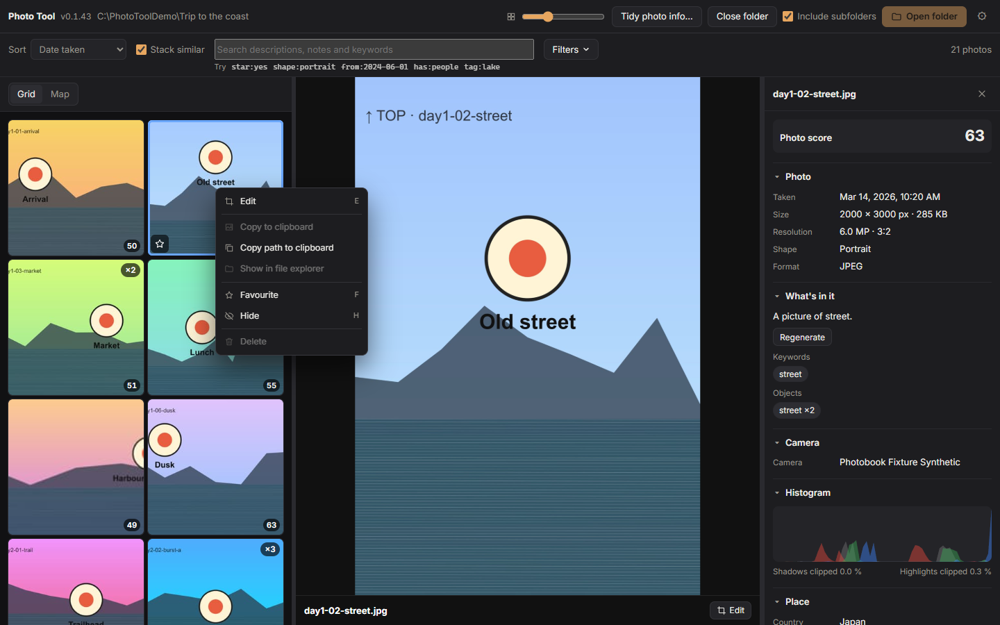

`components/PhotoMenu.tsx`. A right-click on a tile or the preview stage opens the menu at the pointer. If the photo is not in the selection it is selected first; otherwise the selection is kept, so the multi-photo items act on all of them. The context-menu event's default is prevented. The menu is `role=menu`, aria-label "Photo".

#### Layout

```text
+-------------------------------------+   .ctx-menu: position fixed, min-width 220px, padding 4px,
| [crop]    Edit                    E |   radius 9px, bg --panel, border #3a3a40, z-index 60;
| [check]   Save                      |   kept 8px inside the window
| [download] Save as…                 |   (Save / Save as…: only with an unsaved edit)
| [check]   Save all (3)              |   (only while any photo has an unsaved edit)
| [undo]    Revert to original        |   (only with a saved info-file edit and nothing unsaved)
|-------------------------------------|   separators: 1px --line, margin 3px 4px
| [image]   Copy to clipboard         |   desktop only
| [copy]    Copy path to clipboard    |
| [folder]  Show in file explorer     |   desktop only
|-------------------------------------|
| [star]    Favourite | Unfavourite F |
| [eye-off] Hide  |  [eye] Unhide   H |
|-------------------------------------|
| [trash]   Delete                    |   danger (red on hover); desktop only
+-------------------------------------+
```

Items are 12.5px text with 6px 8px padding, a 14px muted icon and an optional `kbd` hint (11px, muted). A disabled item has opacity 0.4. The Save, Save as…, Save all and Revert items appear only while no photo is in edit mode.

| Item | Enabled when | Acts on | What it does |
|---|---|---|---|
| **Edit** (E) | the photo is not being edited and its save is not on its way | the clicked photo | selects it if needed, then `startEdit` |
| **Save** | not saving; not blocked (a HEIC photo in photo-file mode shows the reason as its title) | clicked | `saveEdit` |
| **Save as…** | not saving; desktop `saveEditAs` present (title "Save as needs the desktop app" otherwise) | clicked | `saveEditAs` |
| **Save all (N)** | not saving | every photo with an unsaved edit | `saveAllEdits` |
| **Revert to original** | not saving | clicked | `revertEdit` |
| **Copy to clipboard** | `desktop.copyImage` | clicked | copies the full-size picture; toast "Copied", or `error`/"Couldn't copy the photo." / "Couldn't copy the photo: …" |
| **Copy path to clipboard** | always | `menuTargets(path)`: the selection in the order of the list being looked at, when the clicked photo is selected | the paths joined with `\n`, using `desktop.copyText` when present. Otherwise `navigator.clipboard.writeText`, falling back to a hidden textarea and `document.execCommand('copy')`. Toast "Copied", or "Couldn't copy the path: …" |
| **Show in file explorer** | `desktop.showPhotoInFolder` | clicked | opens the file manager with the photo selected; errors toast `error`/"Couldn't show the photo." |
| **Favourite / Unfavourite** (F) | always | `toggleFlag('star')` targets | the label follows the selected photo's state |
| **Hide / Unhide** (H) | always | `toggleFlag('hidden')` targets | the icon is eye-off for Hide, eye for Unhide |
| **Delete** | `desktop.trashPhotos` | `menuTargets(path)` | The desktop app shows a native confirm and moves the files to the Recycle Bin (Windows) or Trash (elsewhere, decided by the user agent). `cancelled` does nothing; trashed paths are removed from the list (`removeItems`), along with their unsaved edits, and the selection moves on. Failures toast "Couldn't move {name, or N photos} to the {bin}: {first message}"; a thrown error toasts "Couldn't delete: …" |

**Closing the menu.** Any of these closes it:

- choosing an item (the menu closes first, then the action runs);
- a pointer-down outside it;
- Esc;
- a review key (arrows, Home, End, f/F, h/H, e/E, without modifiers);
- any scroll more than 200 ms after opening (`SETTLE_MS`), so the grid's own scroll-into-view on the right-click is ignored;
- the window losing focus, or being resized.

The menu suppresses its own context menu. It is keyed by `path@x,y`, so a new right-click makes a new menu.

### Dragging photos out

The desktop app performs the drag; the page only says which files. On pointer-down (primary button), the page calls `desktop.prepareDrag(paths)` so the files can be checked early. On `dragstart` it calls `desktop.startDrag(paths)`. The list is `dragPaths(grid order, selection, dragged)`.

The server's drag check is limited to 500 paths (`DRAG_MAX`), so a drag takes at most 500 files. A drag that cannot start arrives through `desktop.onDragFailed` as an error toast. In a plain browser nothing happens, because the page's own drag is prevented.

### Edit mode

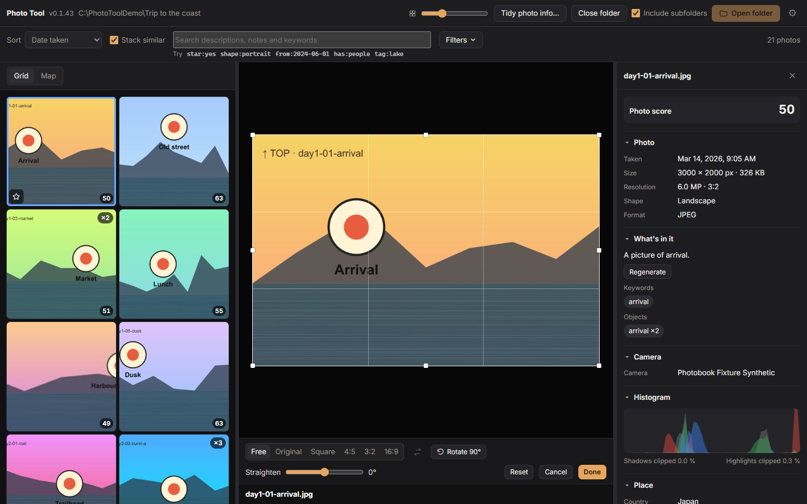

Edit mode crops, turns by quarter turns, and straightens one photo, inside the preview pane. These are the only edits; there are no exposure or colour edits.

**Opening it:**

- the E key;
- the caption's **Edit** button;
- the menu's **Edit**.

`startEdit(path)` is refused while that photo's save is on its way. Editing another photo first ends the current edit as Done would. The viewer cannot open over edit mode.

#### Layout

```text
+--------------------------------------------------------------------------+
| EDIT STAGE (flex 1; 24px kept round the frame so the handles can be held)|
|      +-----------------------------------------------------------+       |
|      | whole photo, turned + straightened (nothing cut), fitted  |       |
|      |   ░░░░░░░░░░░░░░░░░░░░░░░░░░░░░░░░░░░░░░░░░░░░░░░░░░░░░   |       |
|      |   ░░  ■----------■----------■  ░░  outside dimmed (0.6)   |       |
|      |   ░░  |    :     |     :    |  ░░  rule-of-thirds lines   |       |
|      |   ░░  ■----------+----------■  ░░  8 handles: 18px hit,   |       |
|      |   ░░  |    :     |     :    |  ░░  8px white square       |       |
|      |   ░░  ■----------■----------■  ░░  drag inside = move     |       |
|      +-----------------------------------------------------------+       |
+--------------------------------------------------------------------------+
| TOOLBAR (#18181a, padding 8px 12px, wraps, gap 8px 10px)                 |
| [Free|Original|Square|4:5|3:2|16:9] [swap] [↺ Rotate 90°]                |
| Straighten [-45 ===o=== +45] +2.5°  (slider 140px)  [Reset] [Cancel] [Done] |
+--------------------------------------------------------------------------+
| caption: name and badges only (no action buttons while editing)          |
+--------------------------------------------------------------------------+
```

**Edit model** (`shared/core/photoEdit.ts`):

```ts
interface CropRect { x: number; y: number; w: number; h: number }   // fractions 0..1
interface PhotoEdit {
  rotate: 0 | 90 | 180 | 270;   // clockwise quarter turns
  straighten: number;           // degrees clockwise, −45..45
  crop: CropRect;               // fractions of the frame
}
IDENTITY_EDIT = { rotate: 0, straighten: 0, crop: { x: 0, y: 0, w: 1, h: 1 } }
```

**Order of operations**, on the upright photo (EXIF orientation already applied):

1. Turn clockwise by `rotate`.
2. Turn by `straighten`, then keep the largest centred rectangle with the step-1 aspect ratio that fits wholly inside (the "frame"). The frame is the turned size scaled by `straightenScale(w, h, deg) = min(1, w/(w·cos + h·sin), h/(w·sin + h·cos))`, using the absolute angle.
3. Cut out `crop` from the frame.

The server renders with `editPlan` and the page with `editCss`; both go through `straightenScale`, so what is shown is what gets saved.

**Helper functions:**

- **`parseEdit(raw)`** reads a stored edit. It returns null unless `rotate` is a quarter turn. `straighten` is optional; if present it must be finite, and it is clamped to ±45. `crop` is optional; if present, all four fields must be finite. Then `w` and `h` are clamped to [0.01, 1], `x` to [0, 1−w] and `y` to [0, 1−h]. Parsed results are cached per stored object in a WeakMap.
- **`isIdentityEdit`** is true when rotate is 0, straighten is 0, and the crop is within 1e-4 of the full frame.
- **`editKey(e)`** gives a stable cache key: the FNV-1a 32-bit hash, in base 36, of `rotate, round(v × 1e4)…` over straighten and the four crop values.
- **`turnedSize(w, h, rotate)`** swaps width and height for 90 and 270.
- **`editPlan(w, h, e)`** gives the steps in pixels (used by the server): the frame is `round(turned × k)`, at least 1. The extract is `left = clamp(round(x·fw), 0, fw−1)` (and the same for top), `width = clamp(round(w·fw), 1, fw−left)` (and the same for height). `out` is the extract's size.
- **`rotateEditLeft(e)`** turns 90° anticlockwise: `rotate = (rotate + 270) % 360`, and the crop becomes `{ x: y, y: 1 − x − w, w: h, h: w }`, keeping the same part of the picture.

**Edit pane** (`components/EditPane.tsx`):

- **Starting point.** `shownEdit` (the unsaved edit, else the saved one), else identity. The aspect starts at Free, not swapped.
- **Picture.** The 1600px thumbnail, drawn with `EditedImage` using the edit without its crop (`whole`). It is fitted into the stage minus `MARGIN = 24`px on each side, and centred.
- **Crop box.** Placed in percentages of that frame. Its border is 1px white at 0.9. Everything outside is dimmed to 0.6 black. Rule-of-thirds lines are drawn at 33.333% and 66.667% in white at 0.35.
- **Handles.** Eight handles: nw, n, ne, e, se, s, sw, w. Each is an 18px hit area with an 8px white square. aria-labels read "Resize from the top left", "Resize from the top", and so on. Each has the matching resize cursor, and the box itself has a move cursor. Right-click on the stage is suppressed.
- **Dragging.** Pointer capture. Each move calls `resizeCrop(startCrop, handle, dx/frame.w, dy/frame.h, ratio, turnedSize)`.
- **`resizeCrop` rules:**
  - The box stays inside the frame and is never smaller than 5% (`MIN_CROP = 0.05`).
  - With a fixed ratio: a corner keeps the opposite corner fixed. A side edge keeps the opposite edge fixed, with the other dimension following and staying centred. The minimum width is `max(0.05, 0.05 × rf)`, where `rf = ratio × frame.h / frame.w`.
  - Free: each dragged edge is clamped independently.
- **Aspect buttons** (a compact segmented group, aria-label "Aspect ratio"): **Free**, **Original**, **Square**, **4:5**, **3:2**, **16:9**. They are disabled until the picture's size is known.
  - The ratio for each: Free is none. Original is the turned photo's own shape. Square is 1; 4:5 is 0.8; 3:2 is 1.5; 16:9 is about 1.778. The inverse is used when swapped (except 1).
  - Choosing a ratio refits the crop with `fitCropToAspect`: the largest rectangle of that ratio, centred on the old crop's centre and clamped into the frame.
  - Pressing the active button again keeps its swap state.
- **Swap portrait and landscape** (icon button, swap icon; label and title "Swap portrait and landscape"). Enabled only for 4:5, 3:2, 16:9, and Original on a non-square photo. It flips the ratio.
- **Rotate 90°** (button, title "Rotate 90° anticlockwise (R)"). Calls `rotateEditLeft`. For the 4:5, 3:2 and 16:9 aspects it also flips the swap state, so the box turns with the photo.
- **Straighten** (title "Double-click to reset"). A slider from −45 to 45, step 0.5, aria-label "Straighten", followed by the value as "+2.5°", "-3°" or "0°". A double-click on the slider resets it to 0. The crop stays in fractions of the frame.
- **Reset** returns to identity, Free, not swapped.
- **Cancel** (title "Esc") calls `cancelEdit()`: it leaves edit mode, and the unsaved edits stay as they were before editing began.
- **Done** (primary, title "Enter") calls `finishEdit(isIdentity(draft) ? null : draft)`.
- **Focus.** A mouse click on a toolbar button removes focus from it (`detail > 0`), so a following Enter means Done rather than pressing the button again (pinned by e2e).
- **Keys.** A window listener, ignoring modifiers and typing (where the range slider is not counted as typing, so it keeps its arrow keys):

  | Key | Action |
  |---|---|
  | Esc | Cancel |
  | Enter | Done, except when focus is on a button (keyboard-focused buttons keep Enter); auto-repeat ignored |
  | R | rotate; auto-repeat ignored |

- **Reporting the draft.** The draft is reported to the store on every change (`setEditDraft`). The store sets `editDirty` when the draft differs, within 1e-4, from where editing started.

**Ending edit mode:**

- **Done** (`afterDone`). If the result equals the saved edit (none counts as identity), any unsaved edit for the photo is removed. Otherwise it becomes the photo's unsaved edit; `IDENTITY_EDIT` in `pendingEdits` means "remove the saved edit". A photo no longer in the list keeps none.
- **Undo step.** Done records an undo step "crop and rotate" holding the previous unsaved edit, whenever the unsaved edit actually changed.
- **Implicit Done.** Any of these, while editing, ends edit mode as Done would, using the last reported draft (if no draft was reported, the unsaved edits stay):
  - selecting another photo (a click, a key, a marker, the menu);
  - the edited photo being deleted or filtered out;
  - opening another folder;
  - closing the folder.

#### EditedImage (how edits are shown)

`components/EditedImage.tsx` draws an edit with CSS alone; it never asks the server for a rendered image.

- **Structure.** An outer `div.gallery-edited` (position relative, overflow hidden) contains an absolutely placed `` with transform-origin 0 0.
- **Until the picture loads.** Its natural size is unknown, so the image is hidden.
- **`editCss(e, picW, picH, boxW, boxH)`:**
  - `t = turnedSize`, `k = straightenScale`, `fw = t.w × k`, `fh = t.h × k`.
  - `outW = crop.w × fw`, `outH = crop.h × fh`.
  - `f = min(boxW/outW, boxH/outH)`.
  - The image is drawn at `picW × f` by `picH × f`.
  - The transform is `translate((fw/2 − crop.x·fw)·f, (fh/2 − crop.y·fh)·f) rotate(rotate + straighten deg) translate(−width/2, −height/2)`.
  - The box is `(outW·f) × (outH·f)`. All numbers are rounded to 1e-4, with no `-0`.
- **`fit='contain'`** (the default): the outer element takes the box size from `editCss`.
- **`fit='cover'`** (tiles, mini map): the outer element is the full given box. The result is grown by `max(box.w/css.box.w, box.h/css.box.h)` and centred, so the box crops it.
- **Callback.** `onPicture(size)` reports the natural size on every load.

**Where edits show:**

- grid tiles (cover);
- the preview stage (contain, zoomable, with the full-size swap);
- the mini map;
- the edit pane (without the crop).

The viewer shows the plain picture.

**`shownEdit(state, item)`** is `pendingEdits[path]`, else the saved edit. The saved edit is `parseEdit(item.info.edit)` in info-file mode. In photo-file mode it is none, because the file already carries the edit.

#### Saving edits

**The setting.** `editTarget` is `'info'` or `'file'` (Settings, "When I save an edit").

- **Reading it.** `loadEditTarget` uses `desktop.getEditTarget()` when available. Otherwise it reads `localStorage['gallery.editTarget']`; anything other than `'file'` means `'info'`. The store forces `'info'` when `desktop.saveEditToFile` is missing.
- **Changing it.** `setEditTarget` takes effect at once. Saving the setting goes through `desktop.setEditTarget` or `localStorage`. A failure toasts "Couldn't keep the setting: …".

**Copy-only formats.** `copyOnly(path)` is true when the format's `capabilities.editInPlace === false` (`shared/core/mediaFormats.ts`). Only HEIC/HEIF is copy-only, saved as JPEG; JPEG, PNG and WEBP can be saved in place. The note is "{label} photos can only be saved as a copy", for example "HEIC photos can only be saved as a copy".

**`editActions(state, item)`** decides what the caption and the menu offer:

- `save` and Save as… are offered when the photo has an unsaved edit.
- `saveBlocked` is set in file mode for a copy-only photo.
- `saveTitle` is "Save the edit into the photo file (the original goes to the Recycle Bin)" in file mode, else "Save the edit in the photo's info file".
- `saveAsBlocked` is "Save as needs the desktop app" when there is no `desktop.saveEditAs`.
- `saveAll` is the number of photos with unsaved edits.
- `revert` is offered when there is no unsaved edit, the mode is info, and a saved edit exists.

The caption's **Save as…** title, when enabled, is "Save the edited photo as a new file; this one stays as it is". **Save all** is titled "Save every photo's unsaved edit".

**Save** (`saveEdit` → `saveOne`). A second save of a photo already being saved is refused. While a save runs, `savingPaths` contains the photo and `saving` is true, which disables every save button.

- **Info mode.** `saveInfo(path, { edit: isIdentity ? null : edit })`. On success the unsaved edit is removed, unless it changed while the save was on its way.
- **File mode, copy-only photo.** Fails with the copy-only note.
- **File mode, identity edit.** Writes only `{ edit: null }`, and only if an info edit exists.
- **File mode, real edit.** Calls `desktop.saveEditToFile(path, edit)`, which returns `{ ok, saved?, error?, item? }`.
  - `!ok && !saved` is a failure; it toasts `error`, or "Couldn't save the photo."
  - On success, any undo steps that refer to this photo's edits are removed.
  - If the edit changed while saving, a toast says "A later change to {name} was not saved".
  - The unsaved edit is removed. The photo is replaced from `item`, or the folder's info is reloaded.
  - When `!ok` but `saved`, a toast says `error`, or "The photo was saved, but Photo Tool could not read it again."
  - Without a desktop bridge: "Saving into the photo file needs the desktop app".

**Save as…** (`saveEditAs`).

- Needs `desktop.saveEditAs(path, edit, item.info)`, which returns `{ ok, saved?, cancelled?, error?, savedPath?, item? }`. Without it: "Save as needs the desktop app".
- With no edit: "{name} has no edit to save as a copy".
- A cancelled dialog does nothing.
- A copy inside the open folder is added to the grid, or replaces an existing entry with the same path. The original and its unsaved edit stay as they are.
- Success toasts "Saved a copy as {file name}". A partial failure reloads the folder and toasts the error, or "Couldn't save the copy.".

**Save all (N)** (`saveAllEdits`).

- Photos are saved one after another, quietly (no toast for each).
- In file mode, copy-only photos are skipped. Photos already being saved are left to that save.
- Saving stops if another folder is opened meanwhile.
- One toast reports the result:
  - "Saved N photo(s)" (success);
  - "Saved N, M failed: a, b, c…" (error; up to three names, then "…");
  - with skipped photos, ". Skipped {names}: {copy-only note}" is appended, and the toast is info when nothing failed.

**Revert to original** (`revertEdit`) saves `{ edit: null }`, with the undo label "revert to original". Its button title is "Remove the crop and rotation saved in photoinfo.json".

**Leaving with unsaved edits:**

- **Opening another folder or closing this one.** `requestOpen` and `requestClose` first end edit mode as Done. If unsaved edits remain, `leaving` is set and the Unsaved edits dialog opens (see [Other dialogs and toasts](#other-dialogs-and-toasts)).
- **The browser.** The `beforeunload` handler calls `preventDefault` and sets `returnValue = ''` while `unsavedCount > 0`.
- **The desktop app.** It receives `setUnsavedEdits(count)` on every change and asks "Close without saving?" itself.
- **`unsavedCount`.** The number of photos with unsaved edits, plus 1 for the photo being edited when its draft differs and it has no unsaved edit yet.

### Undo (Ctrl+Z)

The undo stack holds at most `UNDO_LIMIT = 100` steps; the oldest is dropped. It is emptied when a folder is opened or closed. A step is:

```ts
interface UndoStep {
  label: string;                                                  // "Undid: hide"
  info: { path: string; before: Record<string, unknown> }[];      // fields as they were; null = absent
  edits?: { path: string; before: PhotoEdit | undefined }[];      // unsaved edits as they were
}
```

**Recording.**

- `saveInfo` records a step automatically unless `undo: false`, and only when the patch changes something. Values still on their way count as current.
- The step is recorded before the reply arrives, so a Ctrl+Z pressed before the reply still takes it back.
- The label is the string passed in, or by default taken from the first patched key:

  | Key | Label |
  |---|---|
  | star | favourite |
  | hidden | hide |
  | scoreAdjust | score |
  | edit | crop and rotate |
  | people | people |
  | description | description |
  | notes | notes |
  | date | date |
  | location | location |

  An unknown key is used as its own label; an empty patch is "change".
- A failed save removes its step.

**`undo()`.**

1. Does nothing while editing.
2. Pops the last step. With none, toasts "Nothing to undo" (info).
3. If none of its photos is still in the folder, toasts "Couldn't undo {label}: the photo is no longer in the folder".
4. Otherwise restores the edits (setting or removing the unsaved edits). For info, `scoreAdjust` is sent the way nudges are; other fields are saved back with `undo: false`.
5. Settles the selection (an unhidden photo comes back where it was), and selects the photo when exactly one photo was involved and it is selectable.
6. Toasts "Undid: {label}" (info), or "Couldn't undo all of: {label}" (error).

### Map view

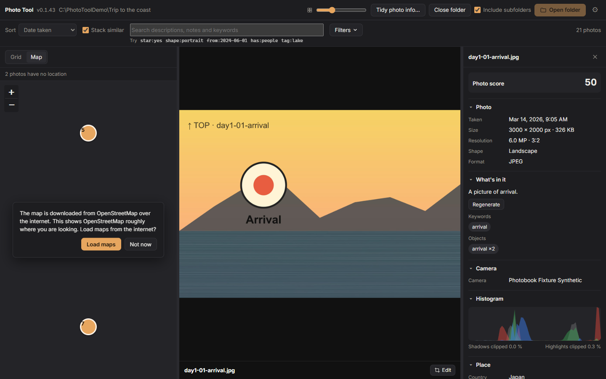


`components/MapView.tsx`, `photo-tool/core/galleryMap.ts`, `photo-tool/web/mapConsent.ts`. The **Map** button of the Grid | Map switch replaces the thumbnails with an OpenStreetMap map. The view (`'grid' | 'map'`) is kept for the session, across folders.

#### Layout

```text
+--------------------------------------------+
| [ Grid | Map ]                             |   view switch (padding 8px 12px)
+--------------------------------------------+
| 3 photos have no location                  |   note (12px, panel bg), only when some lack one
+--------------------------------------------+
| MAP STAGE (flex 1; canvas bg --panel-2)    |
| [+]                         [Map: online]  |   zoom control; toggle top-right (10px), z 1100
| [-]        (12)    (o)(o)                  |   cluster bubble 40px (accent); photo markers 36px round
|                 (o)                        |   selected marker: 3px --select border + white ring
|     +--------------------------------+     |
|     | The map is downloaded from     |     |   consent card (first time only), centred,
|     | OpenStreetMap over the         |     |   width min(360px, 100% − 24px), padding 16px
|     | internet. … Load maps from     |     |
|     | the internet?                  |     |
|     |           [Load maps] [Not now]|     |
|     +--------------------------------+     |
|        [ Map unavailable offline ]         |   status pill, top-centre (12px), when a tile fails
|              © OpenStreetMap contributors  |   attribution (no Leaflet prefix)
+--------------------------------------------+
```

- **Which photos.** The map uses `selectFiltered`: every photo that passes the filter, stacks unfolded.
- **Located photos.** `locatedItems` keeps photos with a finite `effectiveLat` in [−90, 90] and `effectiveLon` in [−180, 180]. The rest are counted.
- **Note.** "1 photo has no location", or "N photos have no location" (formatted for the `en-US` locale), shown only when the count is above 0.
- **The map.**
  - `L.map` with minZoom 1, maxZoom 19, `keyboard: false` (the arrows belong to the review keys), `worldCopyJump: true`, a zoom control, and attribution without a prefix.
  - The initial view is `[20, 0]` at zoom 2. A `ResizeObserver` calls `invalidateSize`.
  - Leaflet's default marker image is disabled (empty URLs), so it is never requested.
- **Markers.** One `L.divIcon` per located photo, class `gallery-map-marker`, 36 × 36px. It is an `` of the 400px thumbnail with `loading=lazy`, so a thumbnail is fetched only when the marker is drawn. Text in the marker HTML is escaped.
  - Look: round, a 2px white border and a shadow.
  - Title: the file name.
  - A click selects the photo.
  - A marker is kept when the photo's key and coordinates are unchanged.
  - The selected marker gets the `selected` class (3px `--select` border, a white ring) and `zIndexOffset: 1000`. When it is off screen, the map pans to it, keeping the zoom.
- **Clusters.** `markerClusterGroup` with `maxClusterRadius: 48`, `showCoverageOnHover: false` and `chunkedLoading`. A cluster is a 40px accent circle with the count in bold and a 3px white border. A click splits it (the Leaflet default).
- **First fit.** On the first batch of markers, the map fits all of them with padding 24 × 24, maxZoom 15 and no animation. The map component is keyed by folder root, so each folder fits again.
- **Consent.** Read with `loadMapConsent`: `desktop.getMapConsent()`, else `localStorage['gallery.mapsOnline']` (`'true'`, `'false'`, or absent for "not asked").
  - **Not yet read:** nothing is shown.
  - **Never asked (`null`):** the consent card shows the exact prompt "The map is downloaded from OpenStreetMap over the internet. This shows OpenStreetMap roughly where you are looking. Load maps from the internet?", with **Load maps** (primary) and **Not now**.
  - **Answered:** a small button **Map: online** or **Map: offline** toggles it. Its title is "Stop loading maps from the internet" or "Load maps from the internet".
  - **Choosing.** Off takes effect at once and is then saved. On is saved first (the desktop app's request guard must allow tiles before they are asked for), then takes effect. A failed save toasts "Couldn't change the map setting." and does not switch on.
- **Tiles.** Loaded only while consent is true: `L.tileLayer('https://tile.openstreetmap.org/{z}/{x}/{y}.png', { maxZoom: 19, attribution: '© OpenStreetMap contributors', referrerPolicy: 'no-referrer' })`.
  - A `tileerror` shows the notice "Map unavailable offline" (`role=status`). A `tileload` hides it.
  - Without tiles ("Not now", or offline), the markers sit on a plain `--panel-2` background.
- **Selection and keys.** On the map, the selectable list is every filtered photo. Left, Right, Home and End step through the grid's list, with folded photos placed between their neighbours. Enter is ignored for a folded photo. Switching back to Grid unfolds the stacks of the selected photos, so the selection stays and is visible (pinned by e2e).

### Settings dialog

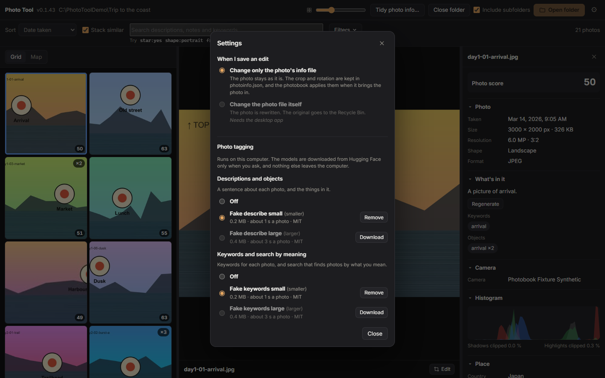

`components/SettingsDialog.tsx` and `components/TaggingSettings.tsx`, inside the shared `Modal`.

**Modal behaviour** (`shared/web/components/Modal.tsx`):

- A backdrop at black 0.55, z-index 50, with 16px padding.
- The dialog is `role=dialog`, 440px wide (`max-width: 100%`, `max-height: 90vh`), background `--panel`, radius 14px.
- Its head has a 15px title and a close × (aria-label "Close"). Its body has padding 8px 16px 16px, a 12px gap, and scrolls.
- **Closing.** Esc (a capturing window listener) or a mouse-down on the backdrop itself closes it.
- **Keys.** Keys inside the dialog do not propagate.

#### Layout

```text
+------------------------------------------------------------+   modal 440px, max-height 90vh
| Settings                                               [×] |
|------------------------------------------------------------|
| When I save an edit                                        |   legend, weight 600
| (o) Change only the photo's info file                      |
|     The photo stays as it is. The crop and rotation are    |
|     kept in photoinfo.json, and the photobook applies them |
|     when it brings the photo in.                           |
| ( ) Change the photo file itself                           |   greyed (opacity .55) in a browser
|     The photo is rewritten. The original goes to the       |
|     Recycle Bin.   Needs the desktop app                   |   (note only in a browser, italic)
|------------------------------------------------------------|   (border-top, margin-top 18px)
| Photo tagging                                              |   13px, weight 600
| Runs on this computer. The models are downloaded from      |
| Hugging Face only when you ask, and nothing else leaves    |
| the computer.                                              |
| Descriptions and objects                                   |
| A sentence about each photo, and the things in it.         |
| (o) Off                                                    |
| ( ) Florence-2 base (smaller)                  [Download]  |
|     277 MB · about 6 s a photo · MIT                       |
| ( ) Florence-2 large (larger) [====    ] [Cancel]           |   progress 90px × 6px while downloading
| Keywords and search by meaning                             |
| Keywords for each photo, and search that finds photos by   |
| what you mean.                                             |
| (o) Off                                                    |
| ( ) CLIP base (smaller)                          [Remove]  |
| ( ) CLIP large (larger)    [Not working · Download again]  |
| +--------------------------------------------------------+ |   confirm strip (accent border)
| | Download X, 1.3 GB, from Hugging Face?  [Cancel][Download]| |
| +--------------------------------------------------------+ |
| (error text, red)                                          |
|                                                    [Close] |
+------------------------------------------------------------+
```

**"When I save an edit"** is a radio group, `name=editTarget`. A change is kept at once through `setEditTarget`. Only one choice can be active, because both at once would apply the crop twice.

1. **Change only the photo's info file** (`info`): "The photo stays as it is. The crop and rotation are kept in photoinfo.json, and the photobook applies them when it brings the photo in."
2. **Change the photo file itself** (`file`): "The photo is rewritten. The original goes to the Recycle Bin." It is disabled without `desktop.saveEditToFile`, with the note "Needs the desktop app".

The checked option gets autofocus.

**Photo tagging** (`TaggingSettings`):

- **Loading.** On mount it loads `GET /api/gallery/models` → `ModelsState { catalogue, installed, settings, downloading, notWorking?, error }`. While loading it shows "Loading photo tagging…", or the error message if the load failed.
- **During a download.** While `downloading` is non-null, it reloads every 500 ms.
- **Parts.** Two parts, each a fieldset:
  - `describe`: **Descriptions and objects**, note "A sentence about each photo, and the things in it.";
  - `keywords`: **Keywords and search by meaning**, note "Keywords for each photo, and search that finds photos by what you mean."
- **Choices in each part.** An **Off** radio, then the catalogue models for that part, with the smaller before the larger.
- **Each model row.** A radio labelled with the model label in bold and "({size})". Beneath it: "{bytes} · about {N} s a photo · {licence}".
  - Bytes are the sum of the model's files, formatted by `formatBytes`: "x.x GB" at 1e9 or more; otherwise "N MB" when 10 MB or more, else "x.x MB".
  - The speed reads "about under 1 s a photo" when the time is below 1 s, else the rounded seconds.
  - The radio is enabled only when the model is installed and `ok`.
- **Actions per model:**

  | Situation | Shown |
  |---|---|
  | this model is downloading | a progress bar (`role=progressbar`, `received/total`) and **Cancel** (`POST …/models/download/cancel`) |
  | installed, ok, and not failing | **Remove** (`DELETE /api/gallery/models/:id`) |
  | installed but not ok, or chosen and in `notWorking` | **Not working · Download again**, plus **Remove** when ok |
  | not installed | **Download** (disabled while any download runs) |

- **Download confirmation.** Download opens a confirm strip: "Download {label}, {size}, from Hugging Face?" with **Cancel** and **Download** (primary, autofocus). Download calls `POST /api/gallery/models/:id/download`.
- **Choosing a model.** It is shown at once, then sent as `PUT /api/gallery/tagging/settings` with the whole settings object. A reload afterwards corrects the display if the server refused.
- **Errors.** Any action error, or `state.error`, is shown in red (`role=alert`).
- **Pausing.** `setTaggingPaused` reads the settings with `GET models`, then writes them back with `paused` changed.

**Close** (`.btn` in the footer) closes the dialog. When Settings closes, What's in it re-reads the descriptions model's label.

### Other dialogs and toasts

**Unsaved edits** (`LeaveDialog.tsx`). Shown while `leaving` is set.

- The modal is titled "Unsaved edits".
- The text is "You have unsaved edits to N photo(s). Open another folder without saving?", or "… Close the folder without saving?" when closing.
- **Cancel** (autofocus) calls `cancelLeave` and keeps the folder open.
- The primary button **Open without saving** or **Close without saving** calls `confirmLeave`, which drops the edits and opens or closes as asked.

**Tidy photo info** (`TidyDialog.tsx`). A wide modal, 680px, opened from the top bar.

- On open it calls `GET /api/gallery/orphans?job=…` → `OrphanedFolder[] { folder, fileNames[] }`. A failure toasts and closes the dialog.
- **States:**
  - "Looking…";
  - "Nothing to tidy: every entry in the photo info files belongs to a photo in the folder.";
  - or the explanation "These entries are for photos that are no longer in their folder. Removing them only changes the photo info files; no photo is touched." followed by a list (max-height 50vh, scrolls). The list groups entries by folder; each folder is shown relative to the open root, or as "(this folder)".
- **Buttons.** **Cancel**, and **Remove N entry/entries** (primary, disabled while busy).
- **Removing.** One `POST /api/gallery/forget { folder, fileNames }` per folder, then the toast "Removed N entry/entries." and the dialog closes. On error it toasts and reloads the list. In either case the folder's info is reloaded afterwards.

**Toasts** (`Toasts.tsx`, `.toasts`). Fixed bottom-right (16px), stacked with an 8px gap, z-index 60.

- Each toast is `--panel-3` with a 3px left edge: `--select` for info, `--error` for error, `--ok` for success. Max width 380px, 12.5px text.
- A click dismisses it.
- It disappears after 7000 ms for an error, 4000 ms otherwise.

### Help, F1 and F2

The page has no help screen, no help button and no F1 or F2 handling; neither key appears anywhere in `photo-tool/web/`. Both are menu accelerators of the shared desktop shell (`shared/electron/runDesktopApp.ts`):

- **F1** is "About Photo Tool".
- **F2** is "Send feedback on GitHub…", present only when a repository is configured.

They work whenever the window has focus, and the page never sees them. The desktop section documents them.

### Client store

`photo-tool/web/store.ts` holds one zustand store, `useGallery`. Module-level variables (outside the store) hold timers and in-flight bookkeeping. Each `open()` bumps a `generation` counter, so timers and replies from an older folder are ignored.

#### State

| Field | Type | Default | Meaning |
|---|---|---|---|
| `job` | `string \| null` | null | the open folder's scan job id |
| `root` | `string \| null` | null | the open folder's path |
| `items` | `GalleryItem[]` | [] | the folder's photos, filled in during the scan |
| `progress` | `{ total, processed, startedAt } \| null` | null | set while the folder is being read |
| `selected` | `string \| null` | null | the photo the preview and details show |
| `selection` | `string[]` | [] | every selected photo, in grid order |
| `anchor` | `string \| null` | null | where a Shift range starts |
| `viewing` | `string \| null` | null | the viewer's photo (null: closed) |
| `thumbSize` | number | saved value, else 160 | tile size, 96–320 |
| `sort` | `GallerySortKey` | `'date'` | session only |
| `filter` | `GalleryFilter` | `{}` | session only |
| `stacked` | boolean | true | Stack similar |
| `openStacks` | `string[]` | [] | ids of unfolded stacks; cleared on open and close |
| `recursive` | boolean | true | Include subfolders, for the next folder opened |
| `recent` | `RecentFolder[]` | [] | `{ folder, recursive, openedAt, exists }` |
| `toasts` | `Toast[]` | [] | `{ id, kind: 'info' \| 'error' \| 'success', text }` |
| `tidyOpen` | boolean | false | |
| `gridCols` | number | 1 | tiles per row as drawn now |
| `view` | `'grid' \| 'map'` | `'grid'` | session only, kept across folders |
| `editing` | `string \| null` | null | the photo in edit mode |
| `pendingEdits` | `Record<path, PhotoEdit>` | {} | unsaved edits; `IDENTITY_EDIT` means "remove the saved edit" |
| `editTarget` | `'info' \| 'file'` | `'info'` | |
| `saving` | boolean | false | true while any edit save runs |
| `savingPaths` | `string[]` | [] | photos whose edit save is on its way |
| `editDirty` | boolean | false | the edit in progress differs from its start |
| `settingsOpen` | boolean | false | |
| `leaving` | `{ folder, recursive } \| 'close' \| null` | null | waiting on "without saving?" |
| `undoStack` | `UndoStep[]` | [] | at most 100 steps |
| `scoreToast` | `{ id, delta: 1 \| -1, path, count } \| null` | null | |
| `tagging` | `TaggingStatus \| null` | null | `{ job, total, done, failed, paused, running, notWorking: TagPart[], stamp, problem }` |
| `meaning` | `{ q, paths } \| null` | null | the results of a search by meaning |

`GalleryItem`, from the server, is the catalogue's photo record plus derived fields:

- **Catalogue fields:** `path`, `folder`, `fileName`, `relDir`, `size`, `mtimeMs`, `width`, `height`, `format`, `capturedAt`, `gpsLat`, `gpsLon`, `camera`, `exif`, `analysis`, `key` (changes when the file changes), `contentKey`.
- **Derived fields:** `info` (the photoinfo entry), `tags: PhotoTags`, `infoSource: 'folder' | 'fallback' | 'none'`, `infoError?`, `effectiveDate`, `effectiveLat`, `effectiveLon`.

The server section defines it in full.

#### Constants

| Name | Value | Meaning |
|---|---|---|
| `THUMB_MIN` / `THUMB_MAX` / default | 96 / 320 / 160 | tile size in px |
| `JOB_POLL_MS` | 500 | scan poll interval |
| `JOB_RETRIES` | 3 | a failed scan poll is retried after 1 s, 2 s, then 4 s, before giving up with an error toast |
| `STAMP_POLL_MS` | 3000 | photoinfo change poll; also the tagging status poll while tagging is idle |
| `TAG_POLL_MS` | 1000 | tagging status poll while tagging runs |
| `TAG_REFRESH_MS` | 10000 | the shortest gap between reloads for new tags while tagging runs |
| `TAG_REFRESH_MS_PER_PHOTO` | 6 | the gap is `max(10000, items × 6)` ms (10,000 photos gives one reload a minute) |
| `FOCUS_COUNT` | 200 | photos sent as tagging focus after the selected one |
| `FOCUS_DEBOUNCE_MS` | 500 | |
| `MEANING_DEBOUNCE_MS` | 300 | |
| `MEANING_MIN_LETTERS` | 3 | |
| `UNDO_LIMIT` | 100 | |
| `SCORE_TOAST_MS` | 1100 | |
| `FACTS_SCAN_THROTTLE_MS` | 2000 | |
| toast lifetime | 7000 (error) / 4000 | ms |

#### Actions

| Action | Behaviour |
|---|---|
| `loadRecent()` | `GET /api/gallery/recent` → `recent`; an error is toasted |
| `open(folder, recursive)` | Cancels the running scan (if any), stops all timers and bumps the generation. Resets `job`, `items`, `openStacks`, the selection, the edits and the undo stack. Sets `root`. Drops `filter.relDir`. Sets `progress = { 0, 0, now }`. Then `POST /api/gallery/open` → `jobId`; on failure: `root = null`, `progress = null`, a toast, and the recent list reloads. Otherwise sets `job`, reloads recent folders, starts watching tagging, and polls the job |
| poll job | `GET /api/gallery/jobs/:id?since=<items.length>` returns only new items, which are appended. `progress` is updated from `{ total, processed, startedAt }`, or set to null when `done`. When done: if nothing is selected, the first visible photo is selected. Read errors toast "N photo(s) could not be read: a, b, c…". Then the photoinfo watch starts |
| watch photoinfo | Takes a baseline `GET /api/gallery/stamp`, then reloads every item once (to catch changes made during the scan). Every 3 s after that, a changed stamp triggers `refreshInfo()`. A failed poll is silent |
| watch tagging | `GET /api/gallery/tagging/status`, every 1 s while running, else every 3 s. The status is kept only if its `job` is this folder's. When its `stamp` changes after the scan has finished, the items are reloaded: on the first reading, when tagging has stopped, or when `max(10 s, items × 6 ms)` has passed since the last reload |
| tagging focus (a subscription) | 500 ms after the job, selection, items, filter, sort, stacking or open stacks change: `POST /api/gallery/tagging/focus { job, paths }`, with the selected photo first, then the first 200 visible photos. Sent only when the list differs from the last one sent. Errors are ignored |
| `saveInfo(path, patch, { quiet?, undo? })` | Records the undo step at once, and remembers the patch as in flight. Saves are queued per photo (`saveQueues`): `PATCH /api/gallery/info { path, patch, job }`. Only when the last queued save finishes is the photo replaced with the newest reply. If the reply's `stamp.before` equals the last stamp seen, `stamp.after` becomes the baseline, so this page's own write does not trigger a reload. A save that lands while a reload is on its way is kept over that reload (`saved` / `saveSeq`). Resolves false after an error toast (unless quiet), and removes its undo step |
| `setStar(path, star)` | `saveInfo(path, { star })` |
| `refreshInfo()` | `GET /api/gallery/items?job=` replaces `items`, keeping saves that finished meanwhile. An error is toasted |
| `select(path)` | see [Selection model](#selection-model); ends edit mode as Done when another photo is chosen |
| `clickSelect(path, mods)` | see the selection model |
| `openViewer(path)` | not while editing; unfolds the photo's stack; `viewing = path` |
| `viewPhoto(path)` | `viewing = path`, only while the viewer is open |
| `closeViewer(last)` | closes; selects `last` alone when it is non-null |
| `setThumbSize(px)` | clamps and saves to `localStorage` |
| `setSort(sort)` | |
| `setFilter(patch)` / `clearFilter()` | merges the patch, or empties the filter; starts a search by meaning if the text changed (always, for clear); settles the selection |
| `toggleTagFilter(f)` | adds the tag filter or removes it; an empty list becomes `undefined` |
| `setTaggingPaused(paused)` | reads models, `PUT` the settings with `paused`, and updates `tagging` (`running = running && !paused`) |
| `regenerateDescription(path)` | `POST /api/gallery/tagging/regenerate` → `PhotoTags` replaces `item.tags`; resolves false after an error toast |
| `setRecursive`, `setStacked`, `toggleStack` | `setStacked` and `toggleStack` settle the selection |
| `toggleFlag(field)` | see [toggleFlag](#toggleflag-f-h-and-the-menus-favourite-and-hide) |
| `removeItems(paths)` | drops the photos and their unsaved edits; settles the selection |
| `close()` | Cancels the scan; `POST /api/gallery/tagging/close { job }` (errors ignored); stops timers; resets everything about the folder, including `tidyOpen`, `tagging` and `meaning` |
| `requestOpen` / `requestClose` / `confirmLeave` / `cancelLeave` | see [Saving edits](#saving-edits) |
| `setTidyOpen`, `setSettingsOpen`, `setGridCols` (at least 1, an integer), `setView` | `setView('grid')` first unfolds the stacks of the selected photos; settles the selection |
| `startEdit`, `finishEdit`, `cancelEdit`, `discardEdit`, `setEditDraft` | see [Edit mode](#edit-mode) |
| `loadEditTarget`, `setEditTarget`, `saveEdit`, `saveEditAs`, `saveAllEdits`, `revertEdit` | see [Saving edits](#saving-edits) |
| `nudgeScore(delta)` | see [Score nudges](#score-nudges-up-and-down) |
| `undo()` | see [Undo](#undo-ctrlz) |
| `toast(kind, text)` / `dismissToast(id)` | |

**Cancelling a scan.** `POST /api/gallery/jobs/:id/cancel` is sent (errors ignored) only when a job is running, that is, while `progress` is set.

#### Derived selectors

All the selectors share one memo, so the grid, viewer, map and keys see the same arrays. The memo is recomputed only when `items`, `sort`, `filter`, `stacked`, `openStacks` or `meaning` change by reference, or when a list built from stale facts outlives the scan.

| Selector | Returns |
|---|---|
| `selectVisible` / `useVisibleItems` | filter, then sort, then fold stacks (when stacked), then the meaning extras. The grid and viewer list |
| `selectFiltered` / `useFilteredItems` | filtered and sorted, stacks unfolded, plus the meaning extras. Used by the map, the preview lookup and "Showing X" |
| `selectStackInfo` / `useStackInfo` | `Map<path, StackInfo>` |
| `selectFacts` | the facts used, or an empty map |
| `selectScores` | `Map<path, PhotoScore>` over all items; memoised on items and facts |
| `selectMeaningStart` | the index in the visible list where the meaning extras begin, or null |
| `selectablePaths` | the visible list's paths on the grid; the filtered list's paths on the map |
| `selectStackPlace(s, path)` | `{ place, size }` in its stack, with the top first |
| `menuTargets(path)` | `dragPaths(selectablePaths, selection, path)`, or `[path]` |
| `shownEdit`, `editActions`, `unsavedCount` | see [Edit mode](#edit-mode) and [Saving edits](#saving-edits) |

#### Desktop bridge used by the page

`connectDesktop(d)` stores the bridge in the module, then:

- subscribes `onOpenFolder` (→ `requestOpen(folder, recursive)`);
- subscribes `onDragFailed` (→ an error toast);
- reports `setUnsavedEdits(unsavedCount)` now and whenever the count changes;
- adds the `beforeunload` guard.

It returns a function that undoes all of this.

| Method | Used for |
|---|---|
| `pickFolder({ title })` | Open folder |
| `onOpenFolder(cb)` | folders from outside the page |
| `prepareDrag(paths)`, `startDrag(paths)`, `onDragFailed(cb)` | dragging out |
| `copyText(text)` → `{ ok, error? }` | Copy path |
| `copyImage(path)` → `{ ok, error? }` | Copy to clipboard |
| `showPhotoInFolder(path)` → `{ ok, error? }` | Show in file explorer |
| `trashPhotos(paths)` → `{ trashed, failed: { path, message }[], cancelled }` | Delete |
| `getMapConsent()` / `setMapConsent(on)` | map consent |
| `getEditTarget()` / `setEditTarget(t)` | the edit save target |
| `saveEditToFile(path, edit)` → `{ ok, saved?, error?, item? }` | Save in photo-file mode |
| `saveEditAs(path, edit, info)` → `{ ok, saved?, cancelled?, error?, savedPath?, item? }` | Save as… |
| `setUnsavedEdits(count)` | the window-close guard |

### Client API module

`photo-tool/web/api.ts` is a thin `fetch` wrapper, `call(method, path, body?)`.

- **Requests.** A JSON body is sent with `content-type: application/json`.
- **Replies.** A 204 reply gives `{}`. Otherwise the reply is parsed as JSON, and a parse failure gives `{}`.
- **Errors.** A non-2xx reply throws `GalleryApiError(status, data.error ?? statusText)`.
- **Query strings** are built with `URLSearchParams`.

The server section documents every route in full.

| Client function | Method and path | Body or query | Reply |
|---|---|---|---|
| `recent()` | GET `/api/gallery/recent` | | `RecentFolder[]` |
| `open(folder, recursive)` | POST `/api/gallery/open` | `{ folder, recursive }` | `{ jobId }` |
| `job(id, since)` | GET `/api/gallery/jobs/:id?since=N` | | `JobUpdate { total, processed, startedAt, done, cancelled, errors: { path, message }[], items }` |
| `cancel(job)` | POST `/api/gallery/jobs/:id/cancel` | | `{ cancelled }` |
| `closeTagging(job)` | POST `/api/gallery/tagging/close` | `{ job }` | 204, no body |
| `items(job)` | GET `/api/gallery/items?job=` | | `GalleryItem[]` |
| `stamp(job)` | GET `/api/gallery/stamp?job=` | | `{ stamp }` (the client returns just the string) |
| `people(job)` | GET `/api/gallery/people?job=` | | `string[]` |
| `places()` | GET `/api/places` | | `{ id, name }[]` (fetched once per page) |
| `suggestPlaces(points)` | POST `/api/places/suggest` | `{ points: [lon, lat][] }` | `{ id, name, photos }[]` |
| `orphans(job)` | GET `/api/gallery/orphans?job=` | | `OrphanedFolder[]` |
| `forget(folder, fileNames)` | POST `/api/gallery/forget` | `{ folder, fileNames }` | `{ removed }` |
| `patchInfo(path, patch, job?)` | PATCH `/api/gallery/info` | `{ path, patch[, job] }` (null deletes a field) | `GalleryInfoReply` = `GalleryItem & { stamp?: { before, after } }` |
| `models()` | GET `/api/gallery/models` | | `ModelsState` |
| `downloadModel(id)` | POST `/api/gallery/models/:id/download` | | `{ id }` |
| `cancelDownload()` | POST `/api/gallery/models/download/cancel` | | |
| `removeModel(id)` | DELETE `/api/gallery/models/:id` | | |
| `setTaggingSettings(s)` | PUT `/api/gallery/tagging/settings` | `TaggingSettings` | `TaggingSettings` |
| `taggingStatus()` | GET `/api/gallery/tagging/status` | | `TaggingStatus` |
| `taggingFocus(job, paths)` | POST `/api/gallery/tagging/focus` | `{ job, paths }` | |
| `regenerateDescription(job, path)` | POST `/api/gallery/tagging/regenerate` | `{ job, path }` | `PhotoTags` |
| `search(job, q)` | GET `/api/gallery/search?job=&q=` | | `{ paths }` |
| `thumbUrl(key, size)` (an `` URL) | GET `/api/gallery/thumb?key=&size=s\|m` | | JPEG; `s` = 400px, `m` = 1600px |
| `fullUrl(path, key)` (an `` URL) | GET `/api/gallery/full?path=&key=` | | the full-size upright JPEG; `key` is ignored by the server and used only to bust the cache |

### What the page keeps in localStorage

Every access is wrapped in try/catch. When storage is unavailable, the value is simply not remembered.

| Key | Value | Written by | Notes |
|---|---|---|---|
| `gallery.thumbSize` | integer string, 96–320 | thumbnail slider | invalid → 160 |
| `gallery.gridWidth` | integer string, px | thumbnail column splitter, on release | used only if finite and > 0, then clamped at layout |
| `gallery.detailsWidth` | integer string, px | details splitter, on release | as above |
| `gallery.sections` | JSON `{ [sectionId]: boolean }` | details section headers | ids: photo, whatsinit, camera, histogram, place, people, date, notes. A missing id is open |
| `gallery.editTarget` | `'info'` or `'file'` | Settings | **browser only**; the desktop app keeps this setting itself |
| `gallery.mapsOnline` | `'true'` or `'false'` | map consent | **browser only**; the desktop app keeps it itself. Absent means not asked |

Nothing else persists in the page. The sort, filters, view, stacking, open stacks, Include subfolders and the undo stack all last only for the session.

### Open points

1. **Up/Down comments are stale.** Comments in `Grid.tsx` ("Up/Down step by a row"), on `gridCols` in the store, and in `galleryViewer.ts` (`gridStep` handling ArrowUp and ArrowDown) say that Up and Down move by a row. The code sends Up and Down to `nudgeScore` before `gridStep` is reached, so `gridCols` and the Up/Down cases of `gridStep` are unused by the keys. The code wins.
2. **Thumbnail comment is stale.** The comment on `thumbUrl` in `api.ts` says `'m'` is for "the hover preview". The hover preview is no longer used (an e2e test checks it does not appear). `'m'` now feeds the preview pane, the viewer, edit mode, the histogram and the image cache.
3. **The viewer ignores edits and cannot zoom.** It draws the plain 1600px picture, so an edited photo looks unedited there. This is unlike the tiles and the preview. It may or may not be intended.
4. **S stars only in the viewer.** The viewer accepts S or F; the review screen accepts only F. The menu hint shows F.
5. **Empty column at the start of a scan.** While a scan has started but no items have arrived (`items` empty, `progress` set), `ReviewScreen` and the filter bar are shown, and the thumbnail column says "No photos match the filter". This looks unintended.
6. **Count text includes hidden photos.** "N photos" and the Y of "Showing X of Y" count hidden photos, even though the grid leaves them out by default.
7. **Text search is narrow.** It does not cover people, file names or places, despite the placeholder "Search descriptions, notes and keywords" (which is accurate as far as it goes). Keyword and object tag filters match case-sensitively. The values typed with `tag:` are lower-cased, so a mixed-case keyword from a model could never match a typed word. Whether keywords are always lower case is the server's concern.
8. **`gallery.css` header comment is out of date.** It says colours come from "the editor's styles.css (imported first)". The page actually imports `shared/web/base.css`.
9. **No light theme exists.** The screenshot `12-dark.png` shows the only theme. The `--warn` token is defined but unused here.
10. **Details and preview can disagree.** When `selected` names a photo that is filtered out, the preview is empty, but the Details panel still shows it, because Details looks it up in `items`, not in the filtered list. In practice `settleSelection` usually moves the selection first.
11. **Opening a folder in a plain browser.** Without the desktop bridge, Open folder is disabled. A folder can only be opened in a browser through a recent-folder entry, or by tests calling the store or API directly.
12. **Rounding in the tagging speed text.** `TaggingSettings` writes "about under 1 s a photo" for models below 1 s per photo, which reads oddly. The model labels are Florence-2 base and large for descriptions, and CLIP base and large for keywords. Their sizes come from `photo-tool/core/tagModels.ts`, which the tagging section owns.
13. **Map layering is unverified.** No rule isolates the Leaflet container. `.gallery-map-stage` is `position: relative` with no z-index, and its overlays use z-index 1100. Leaflet's own panes and controls use z-index 400 to 1000. These could paint above the viewer (55), the modals (50) and the toasts (60) while the Map view is shown. The `gallery.css` comment about raising the filter bar to 1200 "so the viewer still covers the bar" implies the viewer is meant to cover the map too. I did not verify this in a browser.
