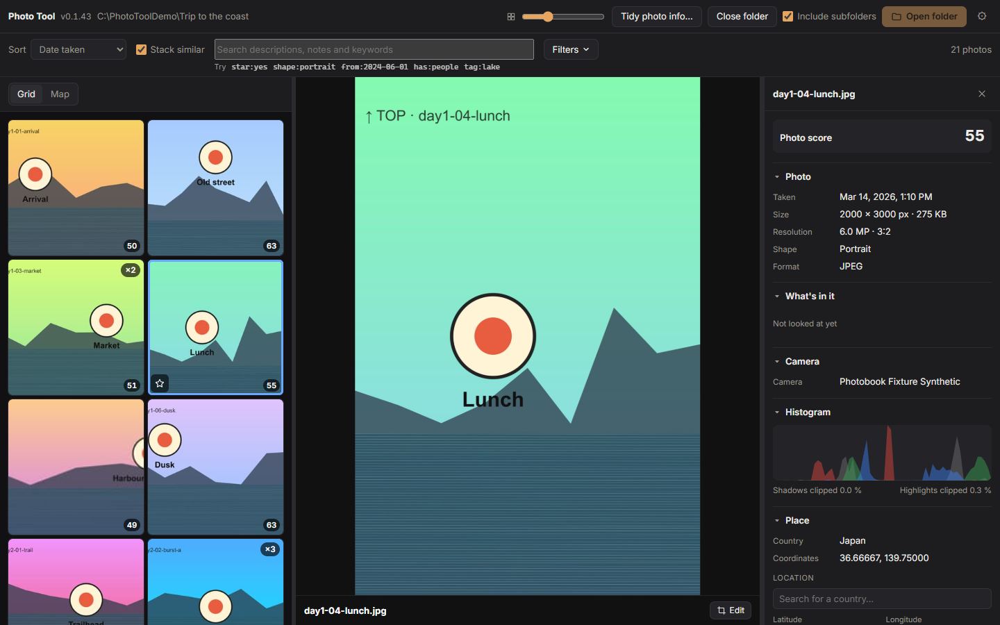

# Photo Tool: design document

This document describes **Photo Tool** (the "Gallery" program) in enough detail to rebuild it without the source. It covers every feature, screen, keyboard shortcut, HTTP route, file format, database table, background process and build step. It does **not** cover the Photobook Editor. Code that Photo Tool shares with the editor (`shared/`) is described only as far as Photo Tool uses it.



## What it describes

- **Version:** Photo Tool **0.1.43**, the local branch `issues-integration` (commit `0b18c30`).
- **Already included:**
  - GitHub issues #2, #3, #4 and #11;
  - phase 1 of #5 and of #7;
  - phase 1 (6a) of #6;
  - the album tags sidecar.
- **Not described yet:** the later phases of #5, #6 and #7, #9 and #10. That work is still in progress, and these pages need updating as it lands.
- **Code wins:** where an older document in `docs/` disagrees with these pages, these pages follow the code.

## Reading order

| Part | File | What it covers |
|---|---|---|
| 1 | [User interface](01-user-interface.md) | Every screen, with layout wireframes and screenshots: the start screen, top bar, grid, preview, details panel, "What's in it", filters and query words, sorting, search, keyboard shortcuts, photo menu, edit mode, map, settings. Also the visual style (theme tokens, fonts, spacing), the client store, and what the page keeps in `localStorage`. |
| 2 | [Server and data formats](02-server-and-data-formats.md) | The local HTTP server and its security model, every route, the `gallery.sqlite` catalogue schema, the folder walker and scanner, content and file keys, thumbnails and decoded images, the media-format registry, the photo-edit model and its rendering, and the album-folder sidecars (`photoinfo.json`, `phototool-tags.json`, `phototool-tags.vectors.json`) with their merge and fallback rules. |
| 3 | [Automatic tagging](03-automatic-tagging.md) | "What's in it": the Florence-2 and CLIP models, model download and verification, the worker protocol, the tagging queue, how descriptions, objects and keywords are derived, embeddings and search by meaning, the tagging routes, and the network rules. |
| 4 | [Desktop program, build, test and release](04-desktop-build-and-release.md) | The Electron shell and the desktop API, startup, the server port, menus (including F1 About and F2 feedback), config and data folders, environment variables, the network guard, update checking and install, the self-test, logs, packaging and installers, CI and release, and the test layout. |

Each part ends with an **Open points** list: things the writer could not determine, or that looked inconsistent in the code.

## Architecture at a glance

```text
┌──────────────────────── Photo Tool (Electron) ────────────────────────┐
│                                                                        │
│  Main process (shared/electron + photo-tool/electron)                  │
│   • window, menus, F1 About / F2 feedback, update check                │
│   • desktop API over IPC: folder dialog, Recycle Bin, reveal,          │
│     clipboard, drag-out, save edits                                    │
│   • starts the local server; network guard (allowed hosts only)        │
│          │ starts and owns                                             │
│          ▼                                                             │
│  Local HTTP server on 127.0.0.1:<saved port>  (photo-tool/server)      │
│   • /api/gallery/* routes ── catalogue: gallery.sqlite (a cache)       │
│   • walker + scanner ─────── thumbnails and decoded copies (a cache)   │
│   • tagging queue ── worker ── Florence-2 / CLIP models (on disk)      │
│   • reads and writes the sidecars in the album folder                  │
│          ▲ fetch, same origin                                          │
│          │                                                             │
│  Renderer: one React page (photo-tool/web), zustand store              │
└────────────────────────────────────────────────────────────────────────┘

Album folder (the source of truth, which travels with the photos)
  photo files (only ever read)
  photoinfo.json                what people typed: star, people, date, place, notes, edits
  phototool-tags.json           generated: description, keywords, objects
  phototool-tags.vectors.json   generated: picture embeddings for search by meaning
  (read-only folder → the same files go in the shared fallback folder)
```

**Principles that shape every part:**

- **Local-first.** Nothing leaves the computer except three things, each one the user asked for:
  - map tiles (OpenStreetMap), after "Load maps";
  - model downloads (Hugging Face), after confirming in Settings;
  - the update check (GitHub releases), which can be turned off in Help.
- **Originals are only read.** Deleting goes to the Recycle Bin, and saving an edit writes a new file or replaces through the desktop shell, never the server.
- **The album folder holds the truth; the data folder is a cache.** Delete the data folder, and opening the album again brings back stars, notes, edits and generated tags.
- **Unknown fields survive** every rewrite of every sidecar. All writes are atomic: a temp file, then a rename.

## Screenshots

The screenshots were taken from the program's own test album (`npm run fixtures` → `fixtures/generated/trip`, 21 synthetic photos), with the window at 1440 × 900. Tagging used the test suite's **fake models**, which name what they see after the file name, so "A picture of lake." is fake model output, not real model output. The map shows markers without tiles because map tiles had not been loaded.

| Screen | Image |
|---|---|
| Start (no folder open) | [01-start.png](images/01-start.png) |
| Grid, preview and details | [02-grid.png](images/02-grid.png) |
| Details panel | [03-details.png](images/03-details.png) |
| Full-screen viewer | [04-viewer.png](images/04-viewer.png) |
| Filter panel | [05-filter-panel.png](images/05-filter-panel.png) |
| Active filter, "Showing X of Y" | [06-filtered.png](images/06-filtered.png) |
| What's in it | [07-whats-in-it.png](images/07-whats-in-it.png), [section only](images/07b-whats-in-it-section.png) |
| Map: first-use prompt, then markers | [08a-map-consent.png](images/08a-map-consent.png), [08-map.png](images/08-map.png) |
| Edit mode | [09-edit.png](images/09-edit.png) |
| Settings | [10-settings.png](images/10-settings.png) |
| Photo menu (right-click) | [11-photo-menu.png](images/11-photo-menu.png) |

To retake them, start the Photo Tool server with temporary folders and `PHOTO_TOOL_FAKE_TAGGING=1` (as `playwright.config.ts` does), open a copy of the fixture album, and capture each screen at 1440 × 900.

## Glossary

| Term | Meaning |
|---|---|
| Album / folder | The folder of photos the user opens. With "Include subfolders" on, its subfolders are included. |
| Catalogue | `gallery.sqlite` in the data folder: a rebuildable cache of what the scanner and tagger found. |
| Content key / file key | Fingerprints of a photo. The content key (a hash of its decoded thumbnail) follows a photo through renames on this computer. The file key (its size plus its first and last 16 KiB) matches it across computers. See part 2. |
| Sidecar | A JSON file beside the photos (`photoinfo.json`, `phototool-tags*.json`). |
| Fallback folder | Where the sidecars go when the album folder cannot be written (`PHOTOINFO_FALLBACK_DIR`). |
| Stack | Near-identical photos (bursts, copies) shown as one tile with a count badge, when "Stack similar" is on. |
| Photo score | A number built from focus, exposure, clipping, colour, composition, people, size and bursts, with +50 for a favourite and −50 when hidden. Up/Down nudge it by 1. The full formula is in part 1. |
| Part (tagging) | One of the two tagging jobs: `describe` (Florence-2) or `keywords` (CLIP). |
| Working image | A browser-viewable copy of a photo the page cannot show directly (for example HEIC). |
